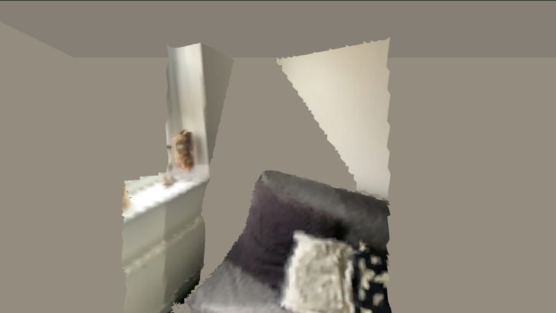
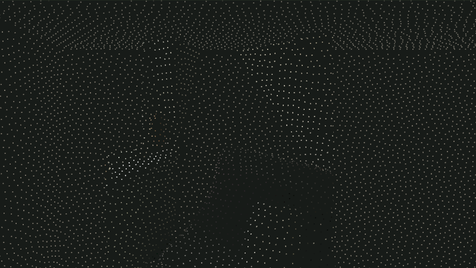
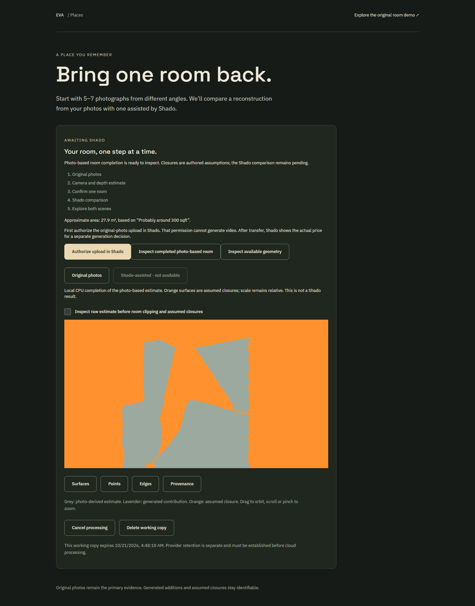

# Actual uploaded-photo result and local completion

2026-10-20. Passed five browser checks after fixing a queued ResizeObserver callback that accessed a cleared canvas during candidate replacement. The failed v1 capture and error record remain preserved.

This uses the actual deployed VGGT result from job `4f2d3dfb-59c5-4c66-9b13-0c21120ccb81`, copied into a separate test-owner session. The model result and source images are unchanged. The automated boundary confirmation is a synthetic test decision, not owner acceptance; this does not claim original-session recovery.

The browser exercised raw surfaces/points, keyboard boundary adjustment, explicit test confirmation, real broker-to-Python CPU completion and the resulting candidate. CPU completion took 22.97 seconds and produced 130,902 triangles, hash `54d032f109c057c7bb731ecb55142622d04f97dafc13877ff2808c012a692250`. No additional GPU, Shado or provider call occurred. The original private job file hash remained unchanged.

The generic upload boundary differs from the curated benchmark boundary; these are separate candidates. Broad flat closures, patchy surfaces and unknown object backs remain. The test proves the workflow executes and renders; it does not establish an accurate complete room.

Reproduce with `node week4/app/scripts/verify-live-upload-copy.mjs <fresh-evidence-directory>` in the reviewed environment. The script uses the existing actual local job, an isolated broker/test owner, and the CPU adapter. It checks that the original job is untouched and rejects unexpected cloud/Shado writes. See `checks.json` for hashes, exact limits and results.
