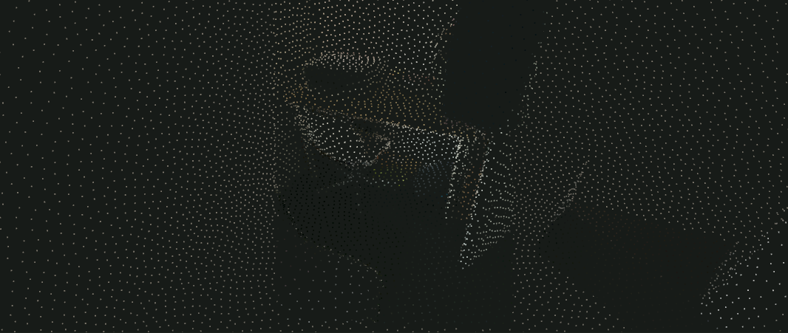
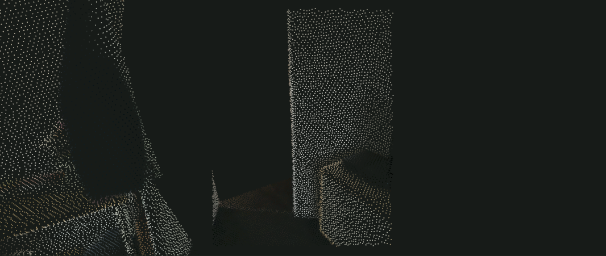

# Actual room candidate: overnight review

2026-10-20. Owner quality acceptance is pending. Base EVA revision `c83fd4c04ca170ed38311b94cdcdebec779051b7` plus uncommitted source. The owner waived the fresh Weave prerequisite for this pass.

Open <http://127.0.0.1:1440/?scene=arkitscenes-room> with the local app and room broker running. This view loads actual saved VGGT output for seven ARKitScenes photographs, dense CPU fusion and a separate one-room completion candidate. It makes no model call.

## Visible changes

- Raw, fused and completed candidates remain available.
- Points are spatially sampled from surfaces, drawn as fixed 1.8 CSS-pixel circles, with depth occlusion to prevent distant walls showing through furniture.
- The inferred hall is clipped to a provisional room boundary. Twelve explicitly authored shell triangles close architectural gaps. These surfaces are assumptions, not measured walls or recovered hidden objects.
- Seven original views, navigation, surfaces, edges and provenance remain inspectable.

## Evidence

`checks.json` records six passing browser checks. The script verifies actual rendered-pixel changes for orbit, zoom, movement and representations, exact Home restoration, keyboard focus, touch emulation, reduced motion, no phone overflow and WebGL loss/reopen recovery. This is headless Edge evidence, not a physical-phone or geometric-accuracy claim.

The selected candidate hash is `eb69dfe4972ec5839faab7f793f809afdaa0c6baf3fa9c69be69c0aa5d78daa9`. It contains 156,584 fused triangles plus 12 authored shell triangles. Original images, model pins, cloud receipts, independent depth diagnostics and failed-view denominators are in the [pilot record](../../../research/ARKITSCENES_PILOT.md).

The root `npm.cmd run check` passed 103 core and 258 application tests, typechecks, the Rust/WASM build and the app production build during this pass. The separate upload renderer teardown fix and its verification are recorded with the actual-upload evidence; they do not change this frozen benchmark candidate.

The later room-workflow verification ran 137 Python tests: 135 passed, with two environment skips (Windows symlink permission and Modal SDK absent from the CPU environment). The Node protocol suite ran 82 tests: 80 passed, with two opt-in process/real-CPU exercises skipped in that default command. Those two exercises passed separately against actual owned processes and the real CPU adapter. No skipped check is counted as passed.

## Remaining limits and review exercise

Move away from the source cameras and inspect chair legs, sofa backs, the window and doorway cap. Compare raw and fused geometry before judging the completed envelope. Confirm that the proposed boundary describes the intended single room and judge whether point spacing preserves recognizable object shapes.

Scale is relative. Hidden object backs, uneven texture and uncertain structure remain. One withheld view registered out of seven; broad novel-view accuracy is not established. A closed shell does not make the room physically correct. Actual Shado generation/comparison remains blocked on an authenticated deployment; no synthetic comparison is presented as real.
