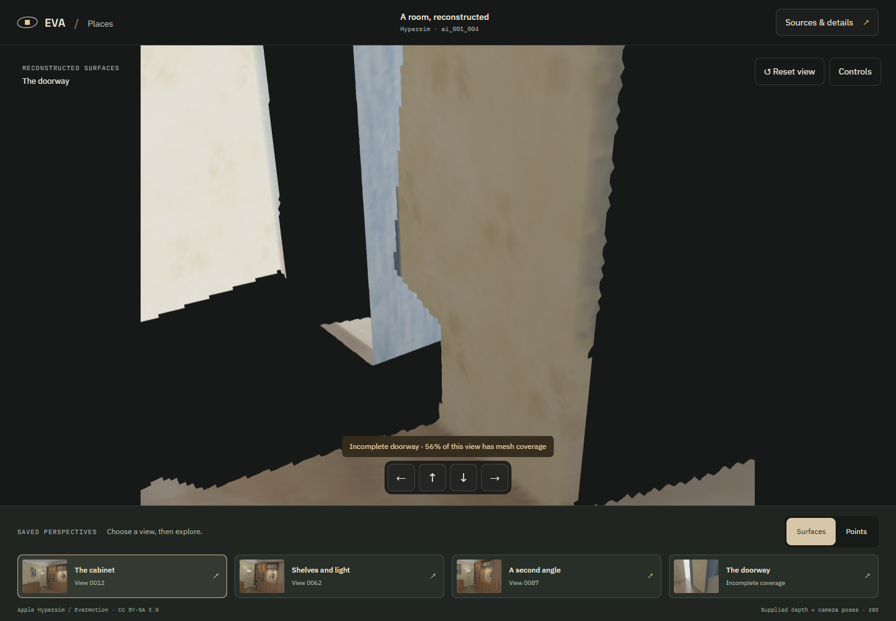
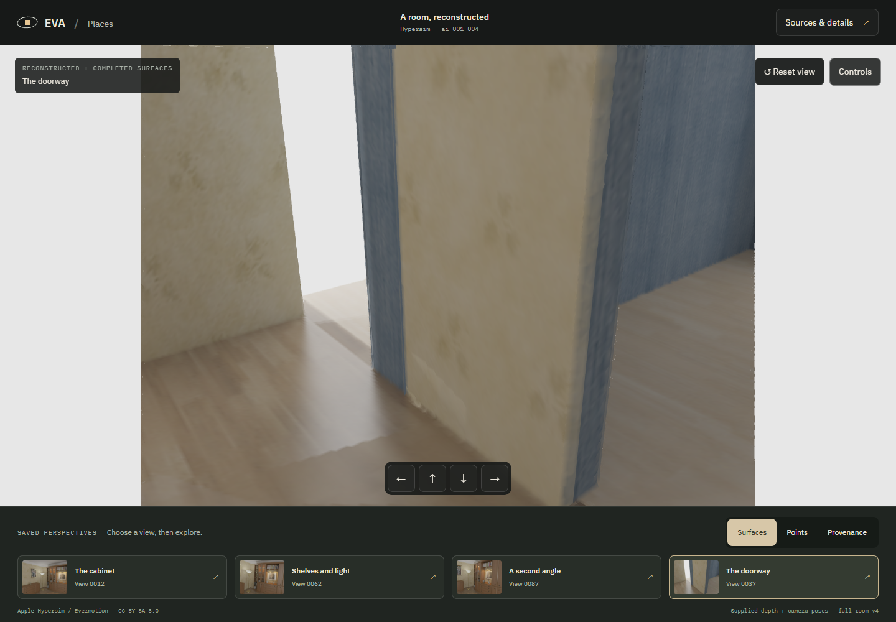
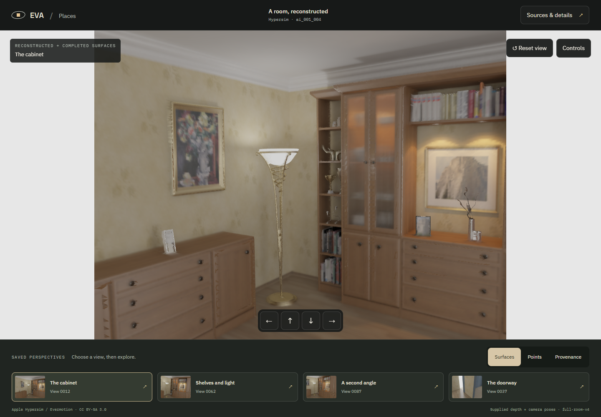
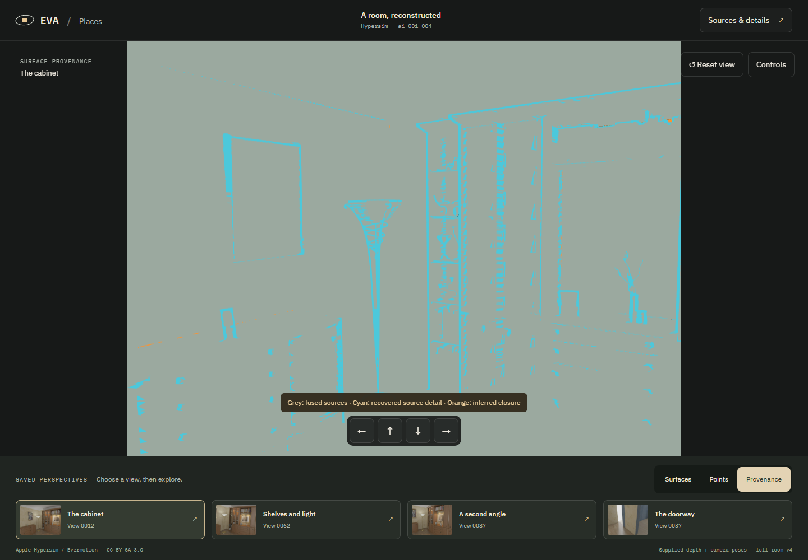
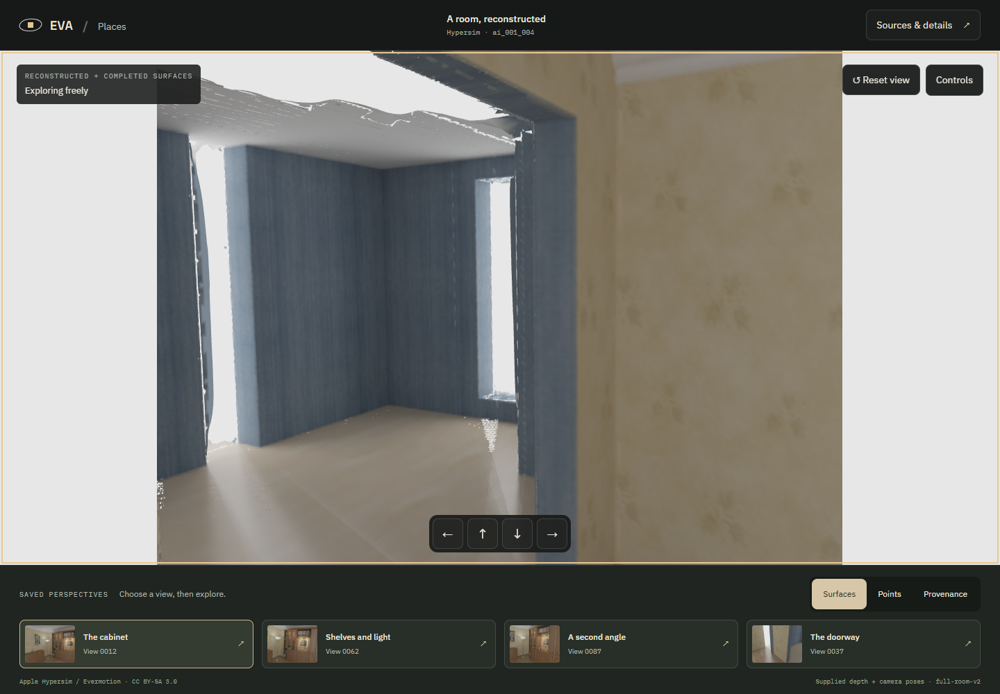
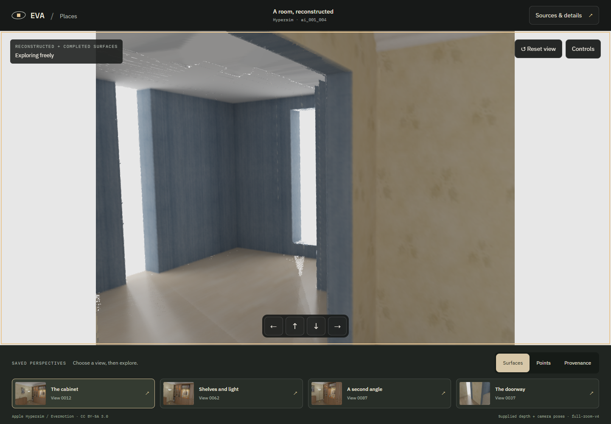
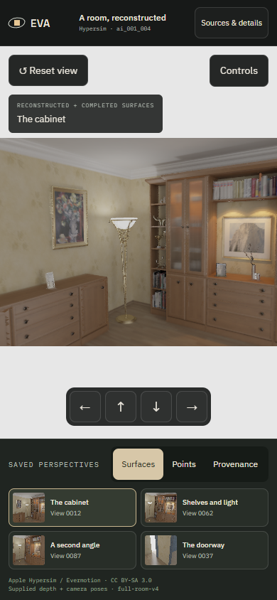

# Room-wide visual demo

Subsequent owner-feedback refinement: [v5 simplified dots and assumed adjoining spaces](../room-refinement-v5/REVIEW.md). The v4 evidence below is preserved.

2026-10-20. The default viewer now loads the all-view room with structural completion and recovered source details. The owner explicitly answered **“Waive Weave for this room-completion pass”**. This packet covers that bounded pass; no new paid Weave reference was generated.

**Open:** [development viewer](http://127.0.0.1:1440/) · [production preview](http://127.0.0.1:1441/) · [recorded browser tour](implementation/tour/room-tour.webm).

| Before: r03 doorway | After: room-wide candidate |
| --- | --- |
|  |  |

| Colored surfaces | Provenance |
| --- | --- |
|  |  |

The **Provenance** control shows fused sources in grey, recovered source detail in cyan, and inferred architectural completion in orange. Switching representation keeps the camera fixed. Sources & details explains the all-100-view conditioning protocol, valid-depth coverage denominator, inferred surfaces and retained original route.

## Look beyond the saved source cameras

The earlier Poisson candidate looked much better in saved views but remained broken when turning around. This prompted the structural completion pass.

| Previous adjoining ceiling gap | Final inferred ceiling |
| --- | --- |
|  |  |

The actual [full-turn recording](implementation/tour/room-tour.webm) includes four quarter-turn captures, saved views, points, provenance and source inspection. [Camera snapshots and browser version](implementation/tour/tour.json). The bright background openings are preserved intentionally. Inferred material seams and simplified surfaces remain visible, especially [behind the source camera](implementation/tour/turn-2.png); this is not a claim of pristine hidden-room recovery.

The 15.72-second, 1440×1000 recording was decoded and played in Edge with no media error ([playback check](implementation/tour/playback.json)). The bundled minimal FFmpeg could not use a null output muxer, so playback verification used the browser instead.

## Verification

- [16 development browser checks](implementation/after/checks.json): actual mesh rendering/counts; point mode; provenance/camera continuity; keyboard move/look/reset and extended walk; mouse drag; source-panel focus restoration; explicit coverage limits; graphics-context recovery; reduced motion; emulated touch; mobile focus trap/inert background; no horizontal overflow; cancellation; truncated download rejection/reload; context loss during loading.
- [Original r03 route checks](implementation/original-route/checks.json): original 96-view route remains functional.
- [Production checks](implementation/production/checks.json): every catalogued asset served with exact size/hash, actual production room/doorway rendering, source-image loading, no page errors.
- [Research results, 51 Python tests and 353 application tests](../../../research/hypersim/evidence/full-room-v4/REVIEW.md).

Initial development readiness was measured by the automation and recorded in its JSON; this is a local headless run, not a native/mobile performance benchmark. Touch was emulated at 390×844 with reduced motion; desktop captures use 1440×1000.



## Re-run the browser evidence

With the local development server running and fresh destination folders:

```powershell
node week4/app/scripts/verify-full-room.mjs .local/full-room-checks http://127.0.0.1:1440/
node week4/app/scripts/capture-room-tour.mjs .local/full-room-tour http://127.0.0.1:1440/
node week4/app/scripts/verify-room.mjs .local/original-room-checks "http://127.0.0.1:1440/?scene=hypersim-room&room=r03"
```

Owner exercise: inspect the doorway, turn through the adjoining room, switch provenance on, return to a source camera, and compare the preserved original route. [Acceptance remains pending](../../acceptance/full-room-v4.md).
