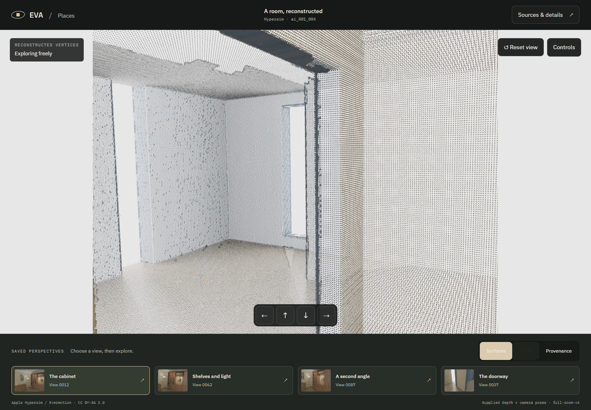
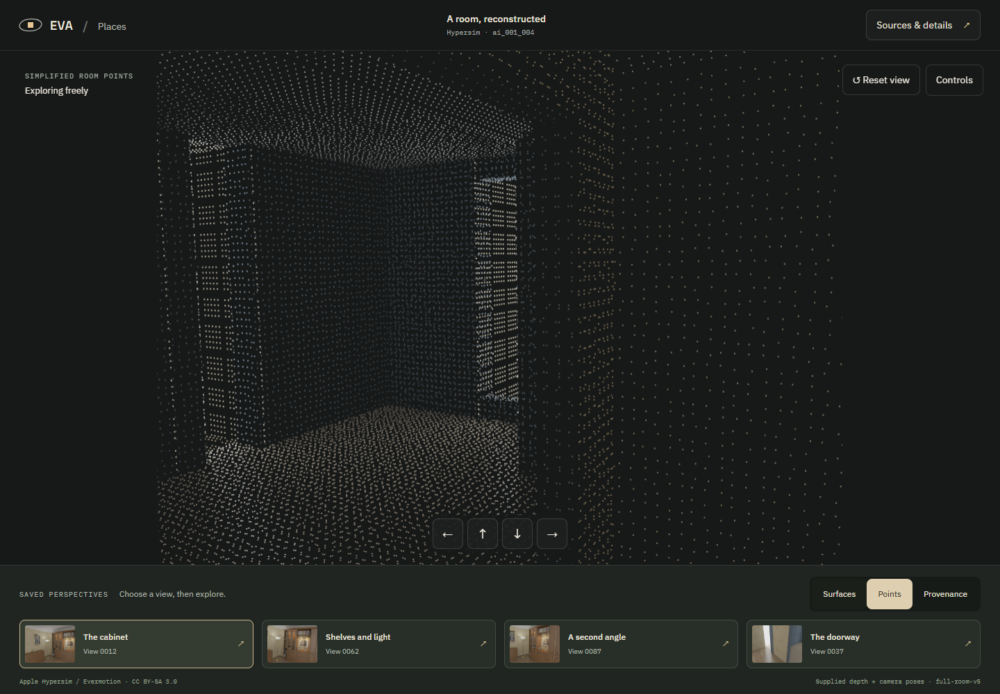
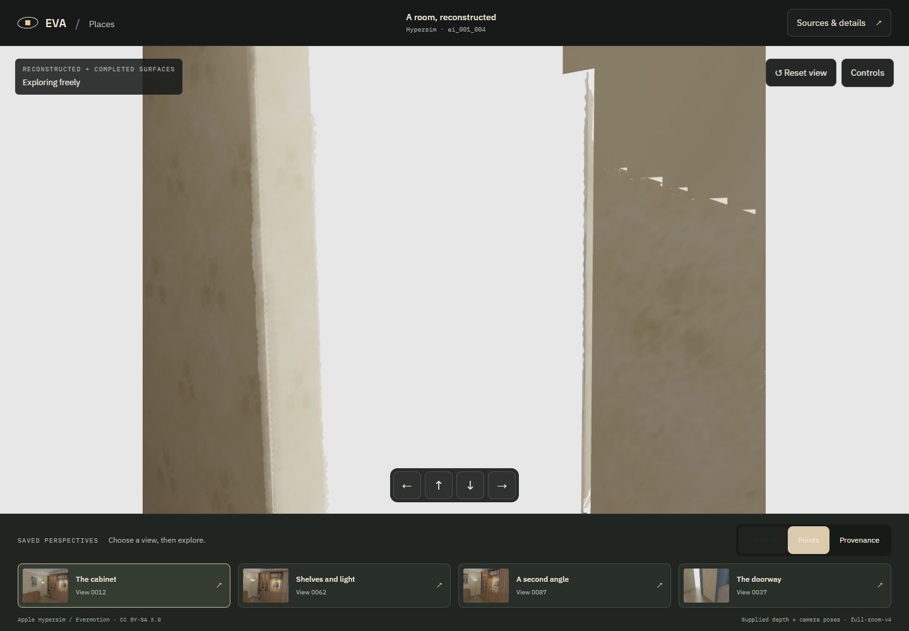
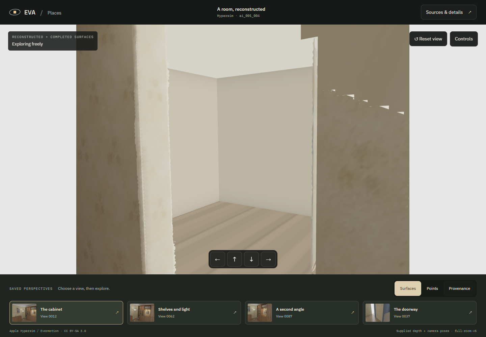
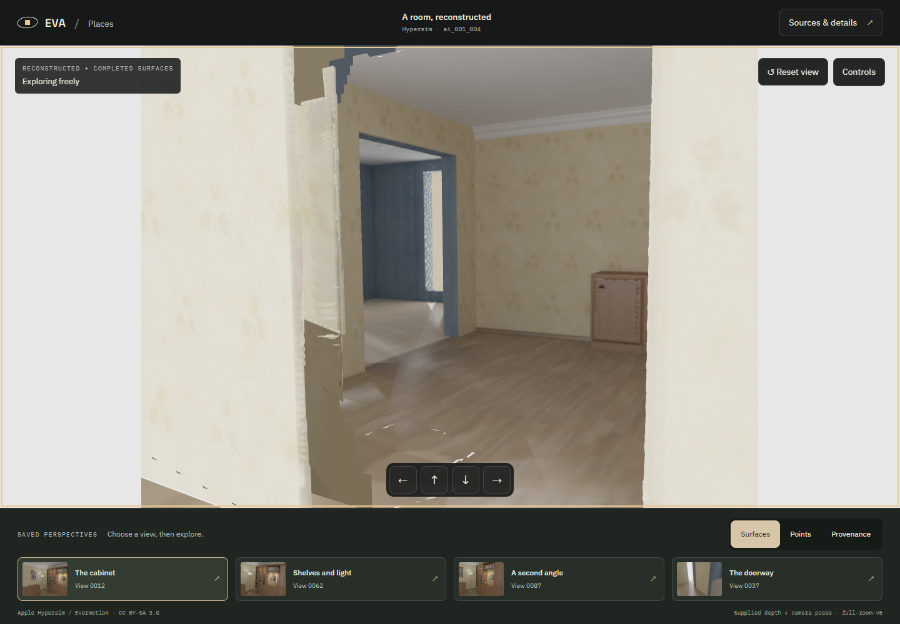

# Simpler dots and filled adjoining spaces

2026-10-20. Owner feedback identified overly dense dots and empty space between walls. This refines the still-unaccepted room-completion pass under its existing explicit Weave waiver. No new generation, installation, download or paid compute.

Open [the viewer](http://127.0.0.1:1440/) or [production preview](http://127.0.0.1:1441/).

## Matching before/after

| Dense original points | Simplified points |
| --- | --- |
|  |  |

| Empty opening | Assumed room behind the opening |
| --- | --- |
|  |  |

Camera poses match for the four-turn comparisons: [before](implementation/before/cameras.json), [after](implementation/after/cameras.json). The added space is actual geometry, not a background image:



## Point display

The previous mode drew all 1,613,659 vertices, including overlapping source-recovery patches. The new display selects an existing vertex nearest each occupied 6 cm voxel centre. It displays **83,575 points from the original candidate plus 25,348 from assumed space: 108,923 total**, about 93% fewer than the previous display despite the added geometry.

Dots have a small round footprint and constant screen size. A depth-only surface pass hides points behind nearer surfaces; the dark background improves separation. Source mesh arrays and surface detail are not decimated. This is a display simplification, not sparse reconstruction or a new scan.

## Space completion

The large white region was beyond the east boundary of the captured geometry. Two narrow background openings belong to the blue room's west and south sides. The new candidate adds an east room with an L-shaped return and two shallow alcoves, with open entrances, continuous floors/ceilings and restrained authored material colors. It adds no inferred furniture.

**Their layout and appearance are assumptions.** They intentionally replace previously unmodeled source-background regions. This is a change from v4's policy of leaving those regions empty. Existing source-supported inference remains orange in Provenance; the new assumed space is lavender.

Use **Sources & details → Show assumed adjoining spaces** to hide/show only this category. The camera stays fixed. Turning it off restores the exact v4 triangle range. Navigation uses the union of the existing room bounds and the four added volumes, rather than a large box encompassing empty corners. It remains bounded free movement, not wall-collision physics.

The [space specification](../../../research/hypersim/evidence/room-refinement-v5/assumed-space.json) records metric bounds. All surfaces use approximately 5 cm triangles. The builder iteratively rejects faces that obstruct existing finite visibility, then verifies convergence. A repeat run produced an [identical mesh](../../../research/hypersim/evidence/room-refinement-v5/reproduction.json).

## Verification

- **53 Python tests passed**, including open portal centerlines and separate assumed-space provenance.
- **103 core + 253 app tests**, typechecks and production build passed. Three new point-sampling tests cover overlapping patches, original-coordinate preservation, negative cells and invalid input.
- [19 browser checks](implementation/checks-final/checks.json) passed, including simplified point counts, exact triangle-range restoration, camera continuity, keyboard/touch toggle access, source-dialog focus, reduced motion, cancellation, graphics recovery and mobile overflow.
- [Production verification](implementation/production/checks.json) passed: all catalogued files served with exact size/hash, actual point/space rendering, source image and toggle; no page errors.
- [Original r03 route](implementation/original-route/checks.json) remains functional.
- [Independent geometry audit](../../../research/hypersim/evidence/room-refinement-v5/audit.json) checked all 100 full-resolution source cameras: original v4 vertex/face/color prefixes are exact; zero new assumed faces move existing v4 hits forward by more than 5 mm; zero new assumed hits conflict with source depth by more than 20 mm; zero existing hits disappear. All four tested entrance centerlines remain open.

Previously unmodeled source-background coverage is now **689,717 / 690,762 pixels (99.8487%)**, with 670,830 intentional assumed-space hits. This is coverage of an authored hypothesis, not increased reconstruction accuracy. Three raycast depth differences select unchanged source-recovered triangles at shared edges; the audit records the numerical/BVH distinction rather than claiming bit-identical rendering.

Browser asset: 1,651,296 vertices, 2,614,619 faces; 37,637 vertices and 72,044 faces are new assumed space. SHA-256: `ad73b2b5087fc37de1e1c5a9363531706946ca4a50fb252a4caa660ec0319f79`. [Manifest](../../../research/hypersim/evidence/room-refinement-v5/scene.json), [source hashes](../../../research/hypersim/evidence/room-refinement-v5/source-hashes.json), [build/test log](../../../research/hypersim/evidence/room-refinement-v5/application-check.txt).

Desktop captures are 1440×1000; mobile checks use 390×844 touch emulation and reduced motion. These are local headless Edge checks, not native or physical-phone claims. Existing reconstruction seams, small slits and uneven materials remain visible. The additions are simple, unfurnished spaces and the combined mesh is not watertight.

## Reproduce

Use fresh output/evidence directories and the existing verified v4 inputs:

```powershell
$roomPython = '.local/reconstruction/venv/Scripts/python.exe'
& $roomPython scripts/reconstruction/adjacent_space.py --source week4/app/public/assets/hypersim-full-room-v4 --output .local/reconstruction/repro-adjoining
& $roomPython scripts/reconstruction/export_full_room.py --source .local/reconstruction/repro-adjoining --raw-source .local/reconstruction/full-room-tsdf-v1 --hybrid-source .local/reconstruction/full-room-structural-v4 --output .local/reconstruction/hypersim-repro-adjoining
& $roomPython -m unittest discover -s scripts/reconstruction -p 'test_*.py'
npm.cmd run check
node week4/app/scripts/verify-full-room.mjs .local/refinement-browser-checks http://127.0.0.1:1440/
node week4/app/scripts/capture-room-refinement.mjs .local/refinement-captures
node week4/app/scripts/verify-room-production.mjs .local/refinement-production http://127.0.0.1:1441
```

The supplementary looking-back capture uses the same starting camera, 20 right-arrow presses, 25 forward presses and 40 further right-arrow presses. [Acceptance remains pending](../../acceptance/room-refinement-v5.md).
