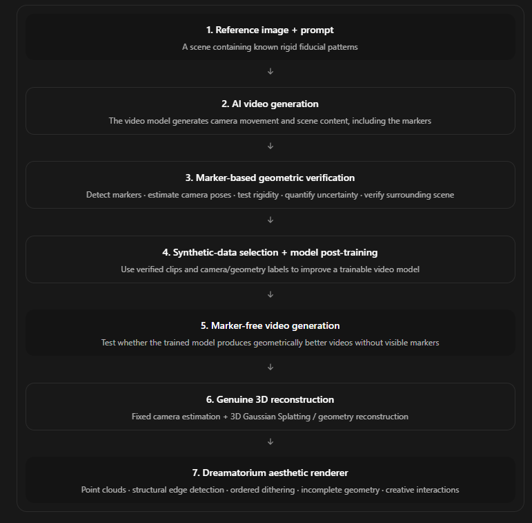

# Dreamatorium — EVA
## Track C Research and Implementation Plan v1.2 — Steps 6–7 and Human–Computer Interaction

**Date:** 2026-10-15  
**Agent:** EVA  
**Implementation repository:** GenUI_Agent  
**Scope:** Steps 6–7: Dreamatorium System B (genuine 3D reconstruction) plus System C (expressive rendering and spatial experience). Steps 1–5 belong to Shado and a separate paper.  
**Paper audience:** HCI researchers and industry practitioners designing interactive generated environments.  
**Status:** Owner-directed scope alignment; implementation phases and research outcomes remain proposed.

> **Final research goal:** Determine how reconstructing and expressively rendering generated video changes people's spatial understanding, exploration behavior, and interpretation of evidence—and whether improvements from Shado's upstream pipeline translate into better human interaction with those environments.

EVA is the agent for Dreamatorium. GenUI_Agent owns Steps 6–7 and the downstream HCI paper. Shado owns Steps 1–5 and the separate model/geometric-learning paper. In EVA's paper, reconstruction and rendering are the enabling system; the main contribution is evidence and design knowledge about human perception, behavior, and interaction. Improved upstream geometry is a hypothesis to verify, not a benefit assumed from the flowchart.

This revision aligns the [canonical scope and roadmap](../../PLANNING.md) and [research proposal](GENERATIVE_UI_INDEPENDENT_STUDY_PROPOSAL.md). The [capability audit](EVA_IMPLEMENTATION_STATUS.md) separates inspected implementation, dated validation, incomplete integration, and future work. The earlier revision-centered plan is preserved in the [history snapshot](history/2026-10-15-before-track-c/README.md). [DESIGN.md](../../DESIGN.md) remains the canonical visual grammar; [AGENTS.md](../../AGENTS.md) governs development.

---

# 1. Track Boundaries and Project Architecture

## Seven-step flow and repository ownership

*Owner-supplied flowchart, preserved unchanged. The diagram describes the proposed pipeline, not completed stages or established effects. The table below records the repository and paper split.*

| Step | Flowchart stage | Repository and paper |
| --- | --- | --- |
| 1 | Reference image + prompt with known rigid fiducial patterns | Shado — upstream model/geometric-learning paper |
| 2 | AI video generation, including camera motion, scene content, and markers | Shado — upstream paper |
| 3 | Marker-based geometric verification: detection, pose, rigidity, uncertainty, surrounding-scene checks | Shado — upstream paper |
| 4 | Synthetic-data selection + model post-training | Shado — upstream paper |
| 5 | Marker-free video generation and transfer testing | Shado — upstream paper; versioned handoff to EVA |
| 6 | Genuine 3D reconstruction with fixed camera estimation and 3DGS/geometry reconstruction | GenUI_Agent / EVA — downstream HCI paper |
| 7 | Dreamatorium aesthetic renderer: points, contours, dithering, incomplete geometry, creative interactions | GenUI_Agent / EVA — downstream HCI paper |

**Paper 1 asks:** Do Steps 1–5 improve held-out video geometry, including marker-free output, beyond matched learning controls?

**Paper 2 asks:** What happens to people's understanding and behavior when those outputs become reconstructed, expressive, interactive environments through Steps 6–7?

The second paper cites the first paper's method, versions, and evidence. It does not rerun or claim ownership of its training contribution. Shared assets or diagnostic reconstruction metrics must be identified as shared; do not present the same results as independent contributions in both papers.

## Step 5 to Step 6 handoff

Shado supplies immutable baseline and treatment marker-free clips, shared scene/prompt-family IDs, model/checkpoint and training-condition identifiers, generation settings/seeds where available, all scheduled attempt IDs, failure records, licenses, evaluation-split membership, and independent upstream quality diagnostics. The treatment name alone does not certify an improvement.

GenUI_Agent adds fixed reconstruction/export settings, raw and stylized scene versions, supported viewpoint ranges, failures, and participant-condition allocation. Match upstream source scenes, prompts, camera requests, generation budgets, resolution, duration, and seeds where supported. No clip is selected for human evaluation because it produced a favorable behavioral result. The main marker-free comparison receives no privileged marker-derived cameras; assisted variants remain separate diagnostics.

## Track terminology

The owner's track labels and the supplied Dreamatorium document's system labels describe different divisions. Keep them explicit:

| Label | Meaning for this program | EVA / GenUI_Agent responsibility |
| --- | --- | --- |
| Track A | Creating or improving the video-generation model, including marker-assisted training | External upstream research; no model-training objective or success claim here |
| Track B | Revision/editing research | Supporting interfaces and reusable mechanisms; not EVA's primary research question |
| Track C | Reconstruction, expressive rendering, and the spatial experience delivered by EVA | Sole research alignment of this repository |
| Dreamatorium System B | Genuine 3D reconstruction | Included in Track C's implementation and evaluation |
| Dreamatorium System C | Computational rendering and spatial interaction | Included in Track C's implementation and evaluation |

A model that supplies video is an input provider. Existing scene-revision mechanisms are support. Neither becomes an EVA research contribution merely because the pipeline uses it.

## Subsystem 1 — Input and Reconstruction

**Input:** Versioned generated video, suitable captured multiview imagery, or controlled synthetic sequences; available camera metadata; source and rights records.

**Process:**

1. Register the input, upstream model/version where relevant, and every attempted sequence.
2. Sample frames using a fixed policy; identify blur, insufficient viewpoint coverage, and nonrigid content.
3. Recover camera poses and sparse structure using an existing validated method.
4. Reconstruct a spatial representation, initially 3D Gaussian Splatting or a compatible point/surface representation.
5. Preserve raw reconstruction, camera estimates, diagnostics, and known coverage.
6. Evaluate held-out views and geometry where independent ground truth exists.
7. Export a versioned scene package for the renderer.

**Output:** A reconstructed, camera-navigable representation with provenance, evaluation records, and explicit limitations.

Optimizing a per-scene Gaussian representation is included. Training or post-training a video-generation backbone is excluded. A single-image particle relief remains a labelled baseline, not a substitute for multiview reconstruction.

## Subsystem 2 — Expressive Spatial Renderer

**Input:** Reconstructed positions, Gaussian attributes or point/surface data, camera matrices, depth/normal information where supported, and optional semantic annotations.

**Process:**

1. Build a shared scene coordinate system.
2. Derive spatially anchored contours, points, material fragments, and selective Gaussian layers.
3. Apply controlled dithering and visibility rules.
4. Compose construction and settling sequences over the actual representation.
5. Preserve spatial attachment during viewpoint changes.
6. Maintain separate raw and stylized inspection modes.
7. Export stills, recordings, and an interactive scene.

**Output:** Dreamatorium's computational visual language applied to genuine scene data.

Intentional fragmentation is tagged separately from missing reconstruction. Screen-space dithering may be an aesthetic layer; structural contours and object attachments must not slide as if they were unanchored image overlays.

## Subsystem 3 — EVA Experience Host

**Input:** User intent, a validated scene package, source material, bounded presentation parameters, and the current session.

**Process:**

1. Let the EVA eye introduce or transition into an experience.
2. Support navigation, selection, raw/stylized comparison, evidence inspection, intensity, pause, and dismissal.
3. Route a small supported set of follow-ups through validated parameters.
4. Preserve relevant state and cancel superseded work.
5. Expose truthful representation and processing status.
6. Record reproducible interaction episodes.

**Output:** An inspectable, interruptible spatial encounter.

Revision features serve usability and experimental control. A superior general editing agent, novel revision model, or longitudinal relationship is not a completion requirement.

---

# 2. Research Questions and Hypotheses

**Primary HCI question:** How do Steps 6–7 affect spatial understanding, exploration behavior, and evidence interpretation, and do geometric improvements established by Shado's Steps 1–5 translate into better outcomes for people using EVA?

The paper centers human outcomes. C-H1, C-H2, and C-H5 establish enabling technical evidence; C-H3, C-H4, and C-H6 carry the HCI argument. A beautiful result does not establish geometric validity; lower reconstruction error does not by itself establish a human benefit.

| ID | Hypothesis or testable proposition | Main test | Result that limits or contradicts it |
| --- | --- | --- | --- |
| C-H1 — Reconstructability | A fixed reconstruction pipeline can produce usable navigable representations for a meaningful proportion of a declared input class. | Controlled/captured benchmarks, then frozen generated-video cohorts; all attempts counted | Low usable yield, unstable cameras, inadequate coverage, or failures concentrated in important scene classes |
| C-H2 — Spatially grounded expression | Anchoring expressive elements to reconstructed geometry reduces viewpoint-dependent drift relative to a matched view-dependent 2.5D baseline. | Identical source material, visual vocabulary, initial framing, and camera-path envelope | Similar or greater drift; benefit disappears outside the starting view |
| C-H3 — Experiential representation | A structured combination of contours, points, and selective materials supports scene interpretation and exploration while offering an expressive experience beyond the raw reconstruction. | Raw versus structured stylization; optional density-matched unstructured stylization | Subject identity or spatial tasks deteriorate without a justified experiential benefit; effects are merely preferred screenshots |
| C-H4 — Evidence legibility | People can distinguish source evidence, inferred geometry, artistic treatment, and unknown regions in the expressive experience without an unacceptable loss relative to a plain/raw inspection mode. | Equivalent labels, source access, content, and tasks across modes | Artistic gaps mistaken for measured absence, generated content mistaken for historical evidence, or increased unsupported beliefs |
| C-H5 — Transfer | The frozen reconstruction/export/rendering grammar works across held-out supported scene families without per-scene manual reconstruction or bespoke shaders. | Held-out scenes/assets and a contrasting category under fixed budgets | Success requires handcrafted geometry or new rules for each evaluation scene |
| C-H6 — Upstream-to-human benefit | Matched marker-free outputs from Shado's treatment condition, if independently shown to improve geometry, support better spatial understanding after the same Steps 6–7 pipeline than baseline outputs. | Matched upstream baseline/treatment clips, frozen downstream pipeline, randomized/counterbalanced participant exposure | Better geometric scores fail to improve human outcomes, cause new costs, or the comparison cannot separate geometry from other changed content |

C-H1 is a feasibility proposition with an advance usable-yield threshold, not a claim that EVA improves the upstream generator. C-H3 has two distinct outcomes: spatial/subject understanding and experiential interpretation. Do not collapse them into an unexplained engagement score.

**Proposed HCI contributions:** evidence about how reconstructed expressive environments shape spatial understanding and exploration; a measured account of whether upstream quality gains reach human outcomes; design guidance for communicating incomplete/inferred space; and an inspectable system and protocol enabling those findings. Reconstruction metrics and a shader implementation support these contributions rather than replacing human evidence.

## Human outcomes and practical relevance

| Outcome | Operational evidence | Interpretation limit |
| --- | --- | --- |
| Spatial understanding — proposed primary | Accuracy on prespecified spatial-relation or viewpoint-transfer tasks with an independently adjudicated answer key | Specify whether the task concerns the displayed virtual scene or a known reference scene; neither implies historical truth |
| Exploration and navigation | Goal-finding success/time, revisits, route efficiency, viewpoint choices, and inspection actions | More time or clicks may mean confusion; do not label them engagement by default |
| Evidence calibration | Correct distinction between source, inferred structure, artistic treatment, and unknown attributes; confidence relative to correctness | Confidence or trust alone is not success |
| Experience and comfort | Open accounts, perceived coherence, effort, discomfort, and aesthetic preference | Researcher-authored ratings are not validated scales; perceived presence is not established without a suitable instrument |

Start with one application context, such as exploring an unfamiliar generated place, and one primary endpoint. Candidate industry implications concern spatial previews, creative exploration, and interpretive exhibits; test a context before claiming benefits across industries. Long-term behavior change, improved learning, or emotional effects require their own measures and designs.

The proposed causal chain is: upstream geometric consistency → reconstruction yield/coverage/artifacts → spatial representation available during interaction → human outcomes. Rendering and interaction design may strengthen, weaken, or reverse that relationship. Associations between adjacent measures do not establish causal mediation.

Existing reconstruction algorithms need not be novel. Novelty of their expressive integration and evaluation must be established through a targeted primary-source review.

---

# 3. Technology and Representation Contracts

| Layer | Proposed technology or retained foundation | Role |
| --- | --- | --- |
| Reconstruction experiments | Python and a reproducible environment | Batch orchestration, manifests, metrics |
| Camera recovery | COLMAP or an explicitly benchmarked alternative | Camera poses and sparse geometry |
| Scene optimization | 3DGS/gsplat-compatible implementation selected in feasibility | Per-scene radiance representation |
| Geometry processing | Open3D or equivalent after format needs are established | Registration, export, geometry metrics |
| Expressive renderer | Existing Three.js browser path or retained Rust renderer with a tested import adapter | Spatial layers, material effects, navigation |
| Application host | React/TypeScript; existing Tauri/Rust boundary for scoped native work | EVA lifecycle, accessible controls, local state |
| Contracts | Versioned JSON Schema and typed loaders | Scene packages, provenance, presentation parameters |
| Source registry | Versioned manifests and approved local assets | Origin, claims, rights, derived artifacts |
| Evaluation | Existing app/Rust checks plus Python/R analysis | Technical tests, fixture replay, research analysis |

COLMAP provides a camera/structure reconstruction pipeline; it is a candidate component rather than a new EVA method. [Official tutorial](https://colmap.github.io/tutorial.html). 3D Gaussian Splatting represents and optimizes a scene for novel-view rendering; visual quality does not automatically establish surface accuracy. [Original paper](https://arxiv.org/abs/2308.04079).

Verify current versions, licenses, GPU requirements, formats, and actual access in Phase 0. No dependency installation or remote compute purchase is implied by this document.

## Scene package

Record scene/version IDs; source asset hashes; upstream generator/checkpoint if known; frame sampling; train/evaluation frame IDs; camera intrinsics/extrinsics; coordinate axes, units, and scale convention; representation type; geometry/Gaussian attributes; optional masks; transforms; raw and derived assets; reconstruction settings; coverage/quality diagnostics; rights; and failures.

Every package must declare one of: source image/video, image-derived 2.5D, authored 3D, captured-data reconstruction, generated-data reconstruction, or controlled synthetic reference. Unsupported fields remain unknown. Gaussian centers are not automatically measured surface points or LiDAR.

Use supplied camera labels in a separately labelled assisted condition. The ordinary generated-video reconstruction benchmark must not receive privileged reference cameras unavailable to its comparison.

## Runtime boundaries

Models may select validated scene packages and bounded presentation parameters. They cannot generate executable renderer code, invent verified source labels, or authorize native effects. Reconstruction workers run outside the interactive animation loop. An authored construction sequence is content, not a truthful percentage of an unknown background job.

---

# 4. Implementation Phases

The full program is a proposed 18–20 working-week sequence after resources and scope are agreed. It is not a semester deadline or phase acceptance. Renderer development can proceed on a genuine reference reconstruction while generated-video reconstruction is evaluated independently.

## Phase 0 — Audit, Feasibility, and Protocol

**Target:** Weeks 1–2.

- Confirm the [current capability audit](EVA_IMPLEMENTATION_STATUS.md) and select a preserved visual baseline.
- Demonstrate a minimal camera-recovery → reconstruction → scene export → renderer-import path.
- Choose a first static-scene input class; defer moving subjects unless a separate method and protocol are justified.
- Establish representation, coordinate, scale, and source contracts.
- Specify reconstruction budgets, failure rules, test splits, and permitted camera paths.
- Choose minimum usable yield, maximum geometry/drift error, and practical rendering budgets from task needs and development data.
- Define C-H3's primary comprehension task and experiential inquiry; prepare ethics/institutional review.
- Agree the Shado handoff and C-E6 baseline/treatment contrast, failure accounting, and readiness criteria before seeing human outcomes.
- Freeze a finite compute/media budget and data rights policy.

**Deliverables:** capability matrix, architecture/format specification, feasibility report, draft protocol, benchmark manifest.

**Exit gate:** One genuine scene can be reconstructed, imported, navigated, and inspected with traceable cameras and raw data. A successful image-to-particle demo does not satisfy this gate. If it fails, continue the labelled renderer prototype and report reconstruction as unresolved.

## Phase 1 — Controlled Reconstruction Benchmark

**Target:** Weeks 3–4.

- Use a small controlled scene with known camera trajectories, dimensions, and geometry.
- Include a captured static multiview scene to test practical data handling.
- Partition fitting and evaluation views before tuning.
- Recover cameras, optimize the representation, and export it.
- Measure registration, held-out rendering, coverage, and geometry accuracy where meaningful.
- Establish a fixed configuration and failure rule.

**Deliverables:** controlled/captured fixtures, raw reconstruction, camera diagnostics, initial C-H1 report.

**Exit gate:** Reproducible reconstruction and measurable errors under stated scale/alignment conventions. A known-camera run is a separate diagnostic, not the unknown-camera result.

## Phase 2 — Generated Visual Input Evaluation

**Target:** Weeks 5–7.

- Register a fixed cohort of outputs from existing video generators or supplied Track A outputs.
- Preserve source prompts, input references, settings, seeds where available, and all scheduled attempts.
- Obtain a matched baseline/treatment Step 5 cohort from Shado when available; keep interim generator/captured fixtures labelled as downstream development evidence.
- Sample frames with the Phase 1 policy; apply the same reconstruction budget.
- Measure failure, usable yield, registration, temporal inconsistency, and supported viewpoint coverage.
- Separate camera motion from moving/deforming subjects.
- Preserve difficult and failed examples instead of retaining only impressive scenes.

**Deliverables:** input manifest, generated-scene packages, failure taxonomy, generated-input C-H1 analysis.

**Exit gate:** Determine whether the declared input class supports useful reconstruction. If yield is too low, narrow the class or use captured/controlled scenes for renderer research. Narrowing after observing results is exploratory scope refinement: retain the original attempts and denominator, freeze the new definition, and use a fresh held-out cohort before making confirmatory yield or transfer claims for it. Do not retrain the upstream video model within this program.

## Phase 3 — Spatial Expressive Renderer

**Target:** Weeks 8–10.

- Import the scene package into the chosen existing renderer path.
- Implement raw reconstruction, points, structural contours, selective materials, dithering, and composite modes.
- Anchor contours and annotations using valid geometry/depth; identify unsupported regions explicitly.
- Implement bounded navigation, resize, resource limits, cancellation, and reduced motion.
- Separate intentional hiding from reconstruction holes.
- Compare raw and stylized outputs under the same camera transforms.
- Construct the matched 2.5D/view-dependent baseline for C-H2.

**Deliverables:** renderer adapter, layer controls, repeatable camera-path captures, C-H2 technical results.

**Exit gate:** Spatial attachment is measured over held-out views, the raw scene remains inspectable, and the stylized renderer does not silently replace missing geometry with an unlabelled image plate.

## Phase 4 — EVA Encounter and Research Conditions

**Target:** Weeks 11–12.

- Integrate the eye-to-scene transition with a valid scene package.
- Keep a labelled authored temporal score for construction, settling, and return.
- Add selection, raw/stylized comparison, representation/provenance inspection, pause, intensity, and dismissal.
- Reuse bounded correction/undo machinery as support where available.
- Keep all essential controls identical across research conditions.
- Prepare raw, structured stylized, and optional unstructured stylized versions.
- Record end-to-end fixtures and actual performance on the declared platform.

**Deliverables:** integrated encounter, condition-fidelity audit, research-ready prototype.

**Exit gate:** People can explore and inspect the same underlying scene across conditions. Native voice, camera tracking, OS windows, and wallpaper behavior require their own scope and real validation; browser success does not establish them.

## Phase 5 — Representation and Interpretation Study

**Target:** Weeks 13–15, dependent on research approval.

- Pilot scene-recognition, spatial-relation, navigation, and evidence-discrimination tasks.
- Counterbalance condition and scene assignment.
- Keep geometry, source content, allowed viewpoints, interaction functions, and information access matched.
- Collect task performance and open descriptions of the experience.
- Analyze where artistic fragmentation clarifies, obscures, or creates false interpretations.
- Run the C-E6 upstream-to-human comparison only when its paired Shado outputs and independent quality evidence are ready; otherwise report that link as untested.
- Keep correction requests available, but do not turn revision superiority into the primary outcome.

**Deliverables:** C-H3/C-H4 results, design principles, negative cases, revised limitations.

**Exit gate:** Produce interpretable findings, including null/adverse results. If participant work cannot proceed, deliver the protocol and artifact and mark human hypotheses untested.

## Phase 6 — Transfer and Integrated Benchmark

**Target:** Weeks 16–18.

- Freeze input adapters, reconstruction settings, grammar, shader parameters/rules, and resource budgets.
- Test held-out source assets and scene families.
- Include at least one non-Paris and one contrasting supported scene category.
- Count manual rescue, geometry authoring, and per-scene shader changes explicitly.
- Report performance and failures by input class and scene family.
- Evaluate the complete input-to-experience chain as well as each subsystem.

**Deliverables:** C-H5 analysis, complete attempt manifests, integrated runtime/cost report.

**Exit gate:** Establish a precise reusable scope. New handcrafted scenery is artistic production, not evidence that the frozen pipeline transfers.

## Phase 7 — Synthesis and Demonstration

**Target:** Weeks 19–20.

- Package the code, public fixtures, schemas, protocols, and analysis.
- Demonstrate input → raw reconstruction → expressive environment → inspection.
- Include a reconstruction failure, an unknown region, and an interrupted encounter.
- Report each hypothesis independently.
- Write the paper around human outcomes, behavior, design implications, and limitations; cite the separate Shado paper for Steps 1–5 and disclose shared datasets/results.
- Prepare the manuscript/thesis chapter and a claim-to-evidence table.

**Deliverables:** reproducible research package, EVA demonstration, final report.

**Exit gate:** An independent reader can trace the visual experience back to source data and distinguish technical findings, artistic decisions, and human evidence.

---

# 5. Dreamatorium Expressive Rendering Engine

## Spatial representation

Retain camera-consistent positions, scales, orientations, colors, opacity, and available depth. Use a bounded camera envelope informed by reconstructed coverage. A navigable representation does not imply complete unseen interiors or accurate surfaces everywhere.

## Structural contours

Use depth discontinuities, surface-orientation changes, multiview-supported features, or annotated boundaries. Document whether each line is image-derived, projected onto a surface, or extracted from geometry. Evaluate attachment during movement; avoid claiming a decorative tracking box is a measured detector output.

## Ordered dithering

Use a development-authored shader with bounded pattern scale, quantization, intensity, and region masks. Compare readability at actual target viewport sizes. Keep exact factual text and essential controls outside effect-only rendering.

## Selective fragmentation

Expose points, Gaussian layers, materials, or partial surfaces intentionally. Preserve a separate mask/record of artistic hiding. Toggle back to the raw representation and show missing reconstruction independently. Do not compute primary geometry scores after artistic removal.

## Temporal construction

Build the experience through spatially meaningful stages such as anchors → structure → materials → selected detail. The stages may be authored over a completed reconstruction. Label them accordingly; detection, optical-flow, and reconstruction-inspired effects do not establish those algorithms ran live.

Temporal construction is a design variable within Track C. Test it later with the same underlying scene and matched information availability if it becomes a research claim. It is not mandatory evidence for every hypothesis.

## Interaction and revision support

Provide navigation, focus/selection, evidence inspection, mode comparison, intensity, pause, reduced motion, and stop. Preserve locks/edits where implemented, but keep revision algorithms and general conversational co-editing outside the primary contribution. Use typed input for the controlled study; add live voice only after separate integration validation.

---

# 6. Experiments and Evaluation

## C-E0 — Pipeline and Runtime Invariants

Validate scene schema, coordinates/units, camera transforms, provenance references, bounded resources, invalid assets, context loss, cancellation, and rejection of stale work. Verify raw/stylized modes use the same scene transform. Inspect rendered behavior in addition to metadata.

**Measures:** valid imports, transform consistency, failures, memory/frame time, local control latency, and recovery.

**Gate:** All enumerated critical tests pass on the frozen candidate. This is finite test evidence, not universal correctness.

## C-E1 — Reconstruction Feasibility

**Target:** C-H1.

Use three separately reported cohorts:

1. Controlled synthetic scenes with independent geometry and cameras.
2. Captured static scenes with sufficient multiview coverage; independent scans only where available.
3. Frozen generated-video sequences, with upstream model identity treated as input provenance.

Begin with a development pilot of roughly 3–5 scenes per cohort. Set final benchmark size, scene strata, and compute budget from that pilot before accessing held-out data. Do not call that pilot a powered comparison.

Freeze frame extraction, resolution, reconstruction settings, optimization budget, retry policy, acceptance rule, and allowable camera region. Frames must represent the same declared scene under the method's assumptions; unrelated archival photographs or different historical states cannot be treated as a coherent multiview capture. In the main unknown-camera condition, estimate cameras from fitting frames only. Evaluation frames do not participate in fitting, threshold selection, or appearance optimization. If evaluation poses must be estimated, document their independent localization procedure and uncertainty; they are not ground truth.

**Primary measure:** Usable-reconstruction yield across all attempted sequences. Define usable in advance through minimum registration/coverage and maximum error thresholds appropriate to the intended navigation task.

**Secondary measures:** Registered-frame fraction, held-out-view error, runtime, memory, artifacts/floaters, camera diagnostics, and geometry accuracy/completeness where independent reference geometry exists. Freeze the image-error metric, camera alignment/scale convention, geometric representation, and distance/completeness thresholds before testing. If a surface is extracted from Gaussians for comparison, fix that extraction method and report its limits; Gaussian centers alone are not a ground-truth surface. Report failure categories and quality conditional on success alongside unconditional yield.

For generated scenes without independently known geometry, report consistency and reconstructability. Neither coherent rendering nor a low reprojection residual proves physical historical truth. Moving subjects need masking or a separately evaluated dynamic method; do not quietly score them as static reconstruction.

## C-E2 — Spatial Attachment

**Target:** C-H2.

Compare the reconstructed spatial renderer with a labelled image-derived 2.5D/view-dependent baseline built from the same source set. Match initial framing, visual vocabulary, density, and access to source imagery as closely as possible; fix the same supported camera paths. Document unavoidable differences in representation capacity.

Measure contour/annotation drift against independent projected reference anchors where available, view-to-view identity consistency, occlusion errors, and artifact rates. Preselect evaluation viewpoints outside the initial matching image. Report cases where the reconstruction itself is wrong.

This comparison tests whether genuine spatial support helps the intended visual language. It does not establish the historical prototype was a reconstruction system, and it must not use trivially impossible views only for the baseline.

## C-E3 — Representation and Experience

**Target:** C-H3; core HCI representation comparison. C-E6 separately tests the upstream-to-human link.

| Condition | Shared content and functions | Varied presentation |
| --- | --- | --- |
| Raw | Same reconstruction, source labels, camera envelope, selection, inspection, and stop | Normal raw representation |
| Structured | Same underlying reconstruction and functions | Geometry-anchored contours, points, selective materials, and declared fragmentation |
| Unstructured, optional | Same reconstruction and functions; approximately matched visibility/density | Similar material vocabulary without the proposed structural selection rule |

**Primary contrast:** Structured versus raw for the practical representation tradeoff. A structured-versus-unstructured contrast can isolate the selection rule more closely if the pilot shows it can be matched credibly. Do not attribute a bundled style comparison to one shader.

Choose one primary comprehension endpoint in Phase 0, such as correctly identifying predefined spatial relationships. Secondary measures include scene/subject recognition, navigation-task success/time, perceived coherence, distraction, comfort, and source inspection. Ask open experiential questions before aesthetic ratings: “What kind of place or material did this suggest?” and “What could you understand or explore, and what remained unclear?”

Hold voice, eye behavior, introductory text, camera/input method, response availability, and session duration constant. Use prerecorded/loaded scene packages to avoid model/network delays contaminating the comparison. Counterbalance equivalent scenes and condition order. Do not pretend every participant must interpret the work in the intended emotional way.

A structured style may be valuable despite a measured tradeoff; report that tradeoff explicitly. Preference alone does not establish comprehension or spatial accuracy. Create task answer keys before participant collection using controlled references or independently adjudicated visible relationships, not the reconstruction algorithm's own correctness score. Distinguish understanding the displayed scene from recovering the original scene's geometry.

## C-E4 — Evidence and Missingness

**Target:** C-H4.

Use the same source/scene package across expressive and plain/raw inspection modes, with identical evidence labels, source-link availability, inspection depth, and task wording. Ask people to distinguish:

- Original source content and its actual provenance.
- Inferred geometry.
- Artistic additions or intentionally hidden surfaces.
- Unknown or unsupported regions.

Ask them to locate supporting evidence and identify whether a gap results from artistic removal or missing reconstruction. Derive item-level answer keys from the actual source, reconstruction, and transformation records. These categories can overlap: an inferred surface may carry source-derived color and an artistic mask. Use attribute-specific questions or allow multiple labels and justified “unknown” answers rather than forcing an exclusive category per object/pixel. A generated Paris scene is not archival evidence simply because archival photographs appear beside it.

Measure classification/source-location accuracy and unsupported-belief endorsement. If testing a special provenance interface, make it a separate treatment rather than changing access in only one style condition.

A formal claim of preserved comprehension needs a prespecified acceptable-loss margin and an adequately justified sample. Small formative null differences cannot establish equivalence or “no harm.”

## C-E5 — Transfer and Complete Pipeline

**Target:** C-H5.

Freeze the pipeline before testing new scenes, sources, and a held-out supported category. Log all reconstruction attempts, manual annotations, corrections, preprocessing, and per-scene authoring time. Report renderer-only transfer on supplied valid reconstructions separately from end-to-end transfer on raw inputs.

A fixed rendering grammar succeeding on hand-built geometry does not establish reconstruction transfer. Successful reconstruction followed by per-scene bespoke shaders does not establish rendering transfer. Report both stages and the complete success rate.

## C-E6 — From Shado Output to Human Outcomes

**Target:** C-H6; required for a claim that Steps 1–5 improve downstream HCI, conditional on the upstream evidence being available.

### Primary two-condition study

Compare Shado's frozen baseline marker-free output with its specified treatment marker-free output for matched scene/prompt families. Process both through identical Step 6 reconstruction, export, budget, failure rules, and one fixed Step 7 rendering/interaction configuration. Randomize or counterbalance participant assignment; use equivalent scene sets to limit learning of the same environment across conditions. Mask checkpoint labels from participants and assessors where feasible.

Use the same primary spatial-understanding endpoint as the prespecified HCI protocol. Record goal-directed exploration, task time/errors, evidence inspection, and comfort as secondary outcomes. Hold hardware, controls, viewpoint envelope, instructions, exposure opportunities, eye/voice behavior, and runtime responsiveness constant where feasible. Document residual differences rather than hiding them.

Match source references, prompts, requested motion, clip lengths, sampling and generation budgets before downstream results are known. Seeds alone do not ensure identical content. Characterize appearance, objects, visual quality, motion, and semantic content as well as geometric consistency. Randomized exposure can identify an effect of the complete upstream treatment on the tested experience; it does not isolate geometry as the sole cause when those other properties also change. Report mediation only with an explicitly justified causal design; otherwise treat geometry-to-behavior associations as explanatory evidence.

### Separate renderer effect and optional interaction

C-E3 compares raw and stylized versions of the same reconstruction and identifies the representation tradeoff. If resources justify a powered interaction test, extend C-E6 to a 2 × 2 design: upstream baseline/treatment × downstream raw/structured style. This tests whether style changes the downstream effect of upstream quality. Do not infer that interaction by combining two underpowered studies. Keep the simpler staged comparisons as the default.

An optional source-video versus interactive-scene comparison can evaluate the practical value of the complete experience. It changes navigation and information access as well as representation, so label it a total-system comparison rather than an isolated reconstruction effect. Match source content and exposure budget and record the remaining affordance differences.

### Reconstruction failures and selection

Report two distinct estimands: (1) all-attempt system availability/yield and (2) human outcomes on a prespecified eligible set. For matched human comparisons, define eligibility without participant outcomes, retain a record of every excluded or failed pair, and report results as conditional on the common reconstructable subset. That subset may be easier and is not representative of all generated attempts.

Where practical, separately study realistic failure/unavailable encounters to estimate whole-system usability. Never invent zero comprehension or missing subjective ratings for failures. Do not combine yield and human scores into a single composite unless the utility definition and analysis were justified in advance. Independent upstream gains, downstream availability, and conditional human benefit are three separate claims.

### Readiness and permissible claims

- Before Shado supplies matched outputs: evaluate C-E3/C-E4 using controlled/captured or clearly labelled existing-generator fixtures; describe a downstream HCI contribution without attributing effects to Shado.
- With matched outputs but no demonstrated geometric gain: compare upstream conditions if useful, but do not label the treatment “geometrically improved” or claim the intended mechanism succeeded.
- With independent upstream evidence and the controlled HCI comparison: report whether the gains do, do not, or inconclusively translate to human outcomes, including failure rates and content confounds.

## Human-study and analysis policy

- Use an initial formative round of approximately 6–8 participants only after required approval; refine tasks, material visibility, and session length.
- Determine confirmatory sample size from the primary contrast, smallest worthwhile effect/loss margin, design, and attrition before recruitment. If infeasible, retain a formative research-through-design claim.
- Treat multiple scenes/episodes within a person as dependent observations. Use a justified paired or hierarchical analysis; report effect sizes, uncertainty, exclusions, and missing data.
- Keep participant research separate from owner/faculty critique and code tests.
- Link qualitative accounts to actual viewpoints/interactions; document analysts, coding, and contrary cases.
- Keep failed attempted episodes in completion reporting. Do not invent ratings for outcomes that could not be observed.
- Freeze the main protocol after the pilot and label later exploratory analyses.

---

# 7. Repository, Data, and Evidence Architecture

Preserve existing week-based work. The following additions are proposed; inspect existing package boundaries before implementation.

| Location | Purpose |
| --- | --- |
| docs/research/ | Protocol, capability status, hypotheses, analysis, results |
| week4/ reconstruction modules or a separately approved successor workspace | Python pipeline, fixed configs, camera/scene export |
| week4/schemas/ | Scene/provenance/representation contracts |
| week4/app/src/ and retained renderer paths | Scene loading, expressive modes, EVA host |
| week4/core/ and week4/broker/ | Reused control/state contracts and explicitly scoped native boundaries |
| fixtures and experiment manifests | Public/synthetic inputs, splits, camera paths, expected outcomes |
| existing design revision directories | Preserved candidates, reference packets, before/after captures, recordings |
| approved private research storage | Consent, participant recordings, identifying data |

Large datasets, generated outputs, model weights, credentials, dependencies, and private records stay out of Git. Version manifests, scripts, configurations, public fixtures, and aggregate results. Preserve source rights and distinguish permitted local use from permission to redistribute.

Each run records input hashes, upstream origin, all attempted sequences, reconstruction config, source/fitting/evaluation split, cameras and alignment convention, representation/renderer version, artistic masks, camera paths, timings, failures, manual interventions, raw/stylized outputs, and scoring protocol.

For C-E6, also record the Shado experiment/checkpoint ID, baseline/treatment pairing, independent geometry diagnostics, human-study eligibility/exclusion reasons, participant allocation, exposure order, and behavior logs. Share only approved public/de-identified artifacts between repositories; participant data belong to the HCI study's approved storage.

Keep the original raw reconstruction immutable for a run. Artistic changes produce derived representations. Existing R11/R12 and authored Rust examples remain labelled comparison assets.

---

# 8. Research Integrity Requirements

1. Exclude upstream video-model training and revision-method superiority from EVA's primary research claims.
2. Distinguish authored 3D, image-derived depth, genuine reconstruction, and controlled ground truth.
3. Never call Gaussian-shaped sprites trained Gaussian Splatting without actual per-scene optimization evidence.
4. Keep geometric evaluation on raw representations; assess artistic removal separately.
5. Preserve held-out views and scene-level splits; disclose assisted-camera conditions.
6. Retain all attempts and bounded retries, including reconstruction failures.
7. Do not infer physical truth from consistency of generated imagery.
8. Label artistic construction timing and ML-inspired effects honestly.
9. Preserve equivalent interaction and provenance access in comparison conditions.
10. Validate native/voice behavior in its actual environment before claiming it.
11. Keep control local, accessible, interruptible, and independent of model/provider latency.
12. Preserve archives, concurrent edits, scoped owner approvals, and separate institutional study requirements.

---

# 9. Milestone Roadmap

| Milestone | Period | Required outcome |
| --- | --- | --- |
| C-M0 — Feasibility | Weeks 1–2 | Genuine reconstruction/import/navigation smoke test; contracts and protocol |
| C-M1 — Reconstruction baseline | Weeks 3–4 | Controlled/captured benchmark and raw scene evidence |
| C-M2 — Generated inputs | Weeks 5–7 | Frozen generated-input yield/failure analysis |
| C-M3 — Expressive spatial renderer | Weeks 8–10 | Anchored layers, raw mode, C-E2 results |
| C-M4 — EVA encounter | Weeks 11–12 | Eye-to-scene host, inspectable provenance, equivalent study conditions |
| C-M5 — Human evaluation | Weeks 13–15 | C-E3/C-E4 findings; C-E6 if paired upstream outputs are ready, otherwise an explicitly untested bridge |
| C-M6 — Transfer | Weeks 16–18 | Held-out reconstruction/rendering/end-to-end report |
| C-M7 — Synthesis | Weeks 19–20 | Reproducible artifact, paper/report, demonstration |

C-M identifiers avoid reusing historical E1, S0–S4, or Week 4 acceptance steps. No earlier acceptance automatically transfers. Keep the existing ComfyUI S2/S3 installation gate intact unless separately revised; it is not a dependency of this program.

Shado's Step 5 handoff is a dependency for C-E6, not a requirement to stop all downstream work. If it arrives later, the C-E6 study and full cross-paper claim require additional time; the nominal schedule does not imply upstream completion.

---

# 10. Minimum Viable Research Milestone

**Target:** A bounded 4–6-week proof of the combined reconstruction/rendering path, subject to feasibility.

1. Reconstruct one controlled or captured static scene from multiview input.
2. Preserve cameras, raw representation, fitting/evaluation split, and known limitations.
3. Run at least one declared generated-video input through the same pipeline and report failure if it fails.
4. Import a valid reconstruction into EVA's renderer.
5. Implement raw, points/contours, and one composite stylized mode.
6. Navigate a bounded camera path and measure spatial attachment.
7. Provide representation/source inspection, stop, reduced motion, and raw/stylized comparison.
8. Record an EVA eye-to-scene encounter using an honestly labelled authored construction timeline.
9. Produce a technical report and a small formative protocol.

**MVP success:** Genuine reconstruction and renderer integration are reproducible; geometry-derived effects remain attached over the declared path; provenance and unknown regions are inspectable; controls remain usable. A generated-input failure is a reported limit, not a reason to relabel source-image particles as reconstruction.

This milestone does not demonstrate improved video generation, arbitrary scene recovery, historical truth, or participant benefits.

---

# 11. First Seven Working Days

| Day | Work | Output |
| --- | --- | --- |
| 1 | Audit current candidates; preserve the chosen visual baseline; select one controlled/captured static scene | Capability matrix and source manifest |
| 2 | Choose reconstruction tool versions, format, coordinates, scale, budget, and evaluation split | Reproducible config and scene contract |
| 3 | Run camera recovery and inspect failure/registration | Camera diagnostics |
| 4 | Optimize/export one actual spatial representation | Raw scene and reconstruction log |
| 5 | Import it into the existing renderer and navigate a fixed path | Genuine scene smoke test |
| 6 | Following current reference-authoring requirements, implement one anchored expressive layer and raw toggle | Matched captures and attachment check |
| 7 | Attempt the first generated sequence, document all results, and review the next bounded phase | Feasibility report and review packet |

This is a proposed implementation sequence. Existing work is not rewritten to force a new stack. Reference generation, paid compute, installations, and native effects retain their applicable authorization boundaries.

---

# 12. Definition of Success

## Level 1 — Reconstruction and Spatial Integrity

The pipeline produces usable representations for its declared input class, with raw data, cameras, failures, and independent evaluation.

Before the held-out run, freeze minimum usable yield, registration/coverage, geometry/rendering error, navigation range, and compute limits from the development pilot and task needs. Report both the fraction that reconstruct and the quality among successes. Success cannot be declared solely because one scene looks convincing.

## Level 2 — Human Interaction and Behavioral Evidence

The computational visual language is derived from the actual representation, remains coherent over the declared view range, and supports inspection. Technical tests demonstrate attachment and control; human evidence establishes interpretation and tradeoffs separately.

A positive C-H3 result needs the prespecified experiential/comprehension evidence with acceptable information costs. A negative result that identifies where fragmentation obstructs understanding is a valid research outcome. C-H4 needs its own evidence; attractive graphics do not prove provenance comprehension.

A claim that Shado's Steps 1–5 benefit human interaction additionally requires C-E6: independently documented upstream quality, the matched downstream comparison, measured human outcomes, and explicit failure/selection accounting. Better reconstruction alone is insufficient. An HCI paper can still contribute a well-supported null effect or downstream design finding while stating that the upstream benefit is untested or absent.

## Level 3 — Reusable EVA Demonstration

EVA takes multiple held-out supported inputs through the declared pipeline and presents inspectable experiences without hidden bespoke rescue. Report reconstruction-only, renderer-only, and full-pipeline results separately.

The final demo shows source input, raw reconstruction, expressive transformation, viewpoint change, evidence/unknown-region inspection, and dismissal. Paris is the flagship, not the entire transfer benchmark.

## Engineering release criteria

All enumerated cancellation, malformed-input, coordinate, source-reference, and state-preservation tests pass. Provisional local targets are p95 stop/acknowledgement within 100 ms and p95 frame time within 33.3 ms on a declared device/scene budget; calibrate on development data and freeze before evaluation. Measure reconstruction and remote-generation latency separately. These are proposed targets, not current results.

## Final package

Deliver a versioned implementation; the seven-step ownership diagram; Shado/EVA handoff contracts; raw and stylized public fixtures; frozen protocols/splits/configs; complete attempt manifests; analysis scripts; grammar/design history; human findings if collected; and a claim-to-evidence table for C-H1–C-H6.

**Proposed HCI paper structure:** human problem and task context → relation to Shado's separate paper → Steps 6–7 interaction system → matched studies → human outcomes and failures → design implications for practitioners → limitations and reproducibility. A possible working title is *From Generated Video to Spatial Experience: Understanding and Exploring Reconstructed Worlds with EVA*.

**Final claim:** EVA contributes evidence and design knowledge about how people understand, explore, and assess reconstructed expressive environments. The extent to which Shado's upstream improvements enable those benefits is an empirical result, not an assumption. Video-model training and revision algorithms remain separately scoped contributions.

---

# 13. Research Basis

- [COLMAP tutorial](https://colmap.github.io/tutorial.html): camera/structure reconstruction workflow; use the official method documentation for implementation decisions.
- [Kerbl et al., 3D Gaussian Splatting for Real-Time Radiance Field Rendering (2023)](https://arxiv.org/abs/2308.04079): per-scene representation and novel-view rendering; not a guarantee of metric surface truth.
- [Vallgårda et al., Temporal Form in Interaction Design (2015)](https://www.ijdesign.org/index.php/IJDesign/article/view/2212/710): temporal behavior as design material; motivates construction studies without establishing EVA's effects.
- [Horvitz, Principles of Mixed-Initiative User Interfaces (1999)](https://www.microsoft.com/en-us/research/publication/principles-mixed-initiative-user-interfaces/): supports retaining explicit user control as infrastructure.
- [Amershi et al., Guidelines for Human-AI Interaction (CHI 2019)](https://www.microsoft.com/en-us/research/publication/guidelines-for-human-ai-interaction/): relevant human-centered design/evaluation context for industry-facing implications; it does not establish EVA's behavioral effects.
- [Existing research synthesis](EXPRESSIVE_RESPONSE_SYNTHESIS.md) and [artistic precedents](ARTISTIC_PRECEDENTS.md): retain their reading-depth and evidence limitations; revision-centered literature now supplies supporting context.

Extend the primary-source review for non-photorealistic rendering, spatial perception, reconstruction evaluation, and uncertainty/provenance visualization before locking the studies. This plan does not claim a completed novelty review.
