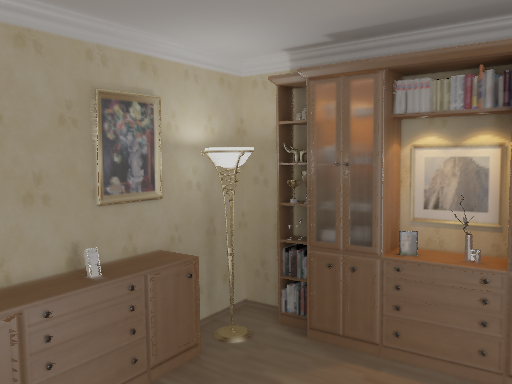
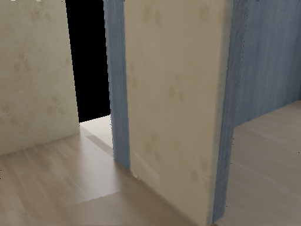
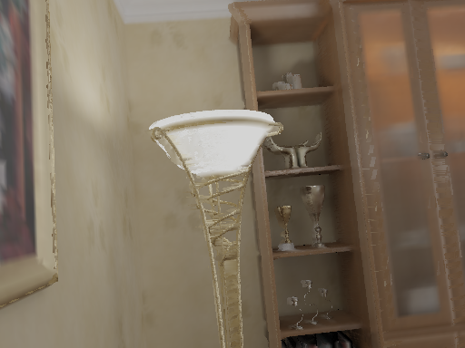
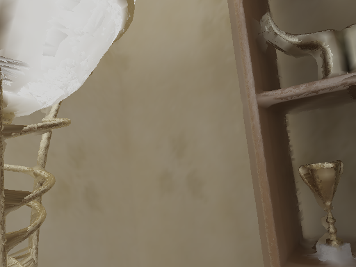

# Room-wide reconstruction and inferred completion

Subsequent owner-feedback refinement: [v5](../room-refinement-v5/REVIEW.md) simplifies the point display and adds a separate assumed-space category behind formerly empty openings. The v4 experiment and evidence below remain unchanged.

2026-10-20. **Implemented and integrated as the default navigable room. Owner acceptance remains pending.** This replaces the floor-only approach with all-view reconstruction, architectural completion and fine-detail recovery. No new model, installation, download, Modal run or paid image generation was needed.

Open [the room](http://127.0.0.1:1440/) or the [production preview](http://127.0.0.1:1441/). [Browser review and recorded tour](../../../../design/revisions/full-room-v4/REVIEW.md).




## Protocol change

This demonstration conditions on **all 100 supplied RGB/depth/camera views**, including frames 0012, 0037, 0062 and 0087. Its measurements are **source consistency, not held-out accuracy**. It does not replace the frozen 96/4 r03 experiment. The original mesh, reports and [original viewer route](http://127.0.0.1:1440/?scene=hypersim-room&room=r03) remain available.

The route uses synthetic Hypersim depth and calibrated poses, not photo-only reconstruction. Hidden architecture and reused material colors are hypotheses. “Room-wide” describes the completion scope; it does not mean exact recovery of all hidden objects, pristine texture, or a watertight printable solid.

## What worked

1. Integrate all 100 full-resolution 1024×768 RGBD views using 15 mm TSDF voxels and 60 mm truncation. Verify the data manifest and camera hash; convert radial distance to camera-Z depth and use the correct half-pixel calibration.
2. Fit source-supported axis-aligned architectural planes. Complete floor and ceiling, extend supported walls, and infer an outer envelope from supported plane positions. Use a 3 cm grid. These extensions are explicitly inferred, including their material colors.
3. Veto proposed triangles against every source depth image using vertices and centroids, a conservative 3×3 depth neighborhood, and a 2 cm front-depth tolerance. Protect source-visible background openings: all-invalid 3×3 source-depth interiors cannot authorize an opaque wall. Finite far depth also remains free-space evidence.
4. Recover full-resolution source triangles missed by fusion, using source RGBD, a 5 cm edge-length cap and scene bounds. This restores thin furniture/lamp details. These additions are source-derived but can overlap other source views; they do not receive the same all-view veto as inferred planes.
5. Export a separate browser asset with explicit fused/inferred/source-recovered ranges, size cap and SHA-256. Re-evaluate the actual float32 browser mesh.

The candidate has **1,613,659 vertices and 2,542,575 triangles**: 1,180,653 fused, 266,083 inferred and 1,095,839 source-recovered faces. Original all-view TSDF arrays are retained; original r03 is separately preserved.

Browser PLY: **57,258,601 bytes**, SHA-256 `b0db49e5a2198cd887ea6e4182200fe2495d45a8044078dfa9f143a886a46770`. Maximum export coordinate change: 0.0000002384 m. [Report](report.json), [source hashes](source-hashes.json), [plane fits and rejection counts](structural-planes.json), [asset manifest](scene.json), [credits](credits.json).

## Measured results

Exact source pixel centers sampled every four pixels, all 100 views, including misses in valid-depth denominators. Mean coverage is the unweighted mean of per-view fractions. MAE is averaged across per-view overlapping pixels.

| Candidate | Mean valid-depth coverage | Worst view | Mean per-view depth MAE | Front conflicts >5 cm / valid pixels |
| --- | ---: | ---: | ---: | ---: |
| All-view TSDF | 99.9092% | 99.1722% | 6.694 mm | 0.4253% |
| Whole Poisson replacement, rejected | 99.99998% | 99.9975% | 15.964 mm | 1.2477% |
| Final structural + source-detail candidate | **99.9947%** | **99.8706%** | **3.809 mm** | **0.5628%** |

Frame 0037: **99.9480% valid-depth coverage**, 4.623 mm overlap MAE. Its 3,003 sampled background pixels have **zero mesh hits**. Background pixels are deliberately excluded from depth-coverage percentages.

Across all views, source-background hits are 1,169/42,845 (2.7284%), compared with the TSDF's 1,167/42,845 (2.7238%): a net increase of two sampled rays. This exposes boundary artifacts rather than concealing invalid source pixels. See [all per-view measurements](consistency.json) and [TSDF measurements](tsdf-consistency.json).

Independent face-category attribution found 1,167 fused hits, two inferred hits (one each in frames 0060 and 0081), and zero source-recovered hits. The exported geometry is finite, index-valid, hash-matched and has zero cross-category faces. Its actual bounds agree with the metadata within float32 precision.

Source recovery lowers average depth error but increases >5 cm foreground conflicts relative to TSDF. Fine object boundaries and overlapping source patches remain imperfect. Views 0059 and 0068 were inspected because they were among the worst conflicts in the preceding candidate:

| View 0059 | View 0068 |
| --- | --- |
|  |  |

## Alternatives actually tried

- **Whole Screened Poisson mesh:** nearly complete source coverage, but smoothed fine objects and introduced bridging surfaces. Rejected as the replacement. [Report](poisson-report.json), [measurements](poisson-consistency.json).
- **TSDF + depth-filtered Poisson patches:** preserved source details, but a 360° browser inspection revealed broken unseen architecture and unhelpful inferred shapes. An initial bounds error was corrected in v2; the approach was still superseded by structural completion.
- **Architectural v3 without background protection:** diagnostic candidate only. Audit found that valid-depth-only filtering could seal source-visible bright openings. The corrected v4 veto protects these openings.
- **Native small-hole filling probe:** the local Open3D build exited without an output; not used.
- Earlier SD2/Weave attempts remain rejected, separately documented and absent from this mesh.

The final method follows the geometry actually available in this synthetic scene. It does not claim general robustness to arbitrary photos or non-axis-aligned buildings. Official [Apple Hypersim documentation](https://github.com/apple-aiml-research/ml-hypersim) provides the public image/depth route and explains access requirements for original source meshes. [Open3D's surface reconstruction documentation](https://www.open3d.org/docs/release/tutorial/geometry/surface_reconstruction.html) informed the Poisson experiment. This pass inspected official documentation/code; it did not perform a new full-paper review.

## Reproduce

Use the existing locked reconstruction environment and verified r03 dataset/camera artifacts. Each output directory must be fresh. No installation or cloud call is part of these commands.

```powershell
$roomPython = '.local/reconstruction/venv/Scripts/python.exe'
& $roomPython scripts/reconstruction/full_room.py reconstruct --output .local/reconstruction/repro-tsdf
& $roomPython scripts/reconstruction/structural_completion.py --source .local/reconstruction/repro-tsdf --output .local/reconstruction/repro-structural
& $roomPython scripts/reconstruction/full_room.py recover --source .local/reconstruction/repro-structural --output .local/reconstruction/repro-recovered
& $roomPython scripts/reconstruction/export_full_room.py --source .local/reconstruction/repro-recovered --raw-source .local/reconstruction/repro-tsdf --hybrid-source .local/reconstruction/repro-structural --output .local/reconstruction/hypersim-repro-browser
& $roomPython -m unittest discover -s scripts/reconstruction -p 'test_*.py'
npm.cmd run check
```

Source hashes identify the uncommitted implementation over base Git revision `70ad76c6888a9bbcc98bea8c2756ed73db0f5132`. No commit or publication was requested. Output counts/hashes should be recorded per reproduction; parallel numerical routines are not promised bitwise deterministic.

## Checks and limits

- **51 Python tests passed**, including background-opening protection, far-depth veto, lineage rejection, cross-category rejection and float32 PLY round-trip precision. [Log](python-tests.txt).
- **103 core + 250 app tests**, typechecks and production build passed. [Log](application-check.txt). The initial sandboxed Vite build was blocked by directory access; the approved local rerun exited 0.
- Development browser, original route, production file hashes, desktop/mobile interactions and recorded full-turn evidence: [browser packet](../../../../design/revisions/full-room-v4/REVIEW.md).
- Edge-incidence audit: zero nonmanifold edges, 651,569 boundary edges across overlapping/unwelded source patches. **Not a watertight solid.**
- New wall extents and material reuse are guesses. Color seams, low-detail hidden surfaces and fine-boundary artifacts are visible in the full-turn evidence. Exterior/background openings remain open; exterior scenery is not reconstructed.
- Four probes per triangle do not prove every triangle interior is conflict-free. Camera controls stay inside bounds but do not perform wall collision detection.
- [Owner acceptance](../../../../design/acceptance/full-room-v4.md) is pending. No full memory-palace, photo-only reconstruction, native-device, or study milestone is accepted by this result.
