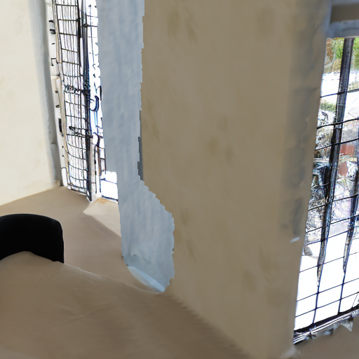
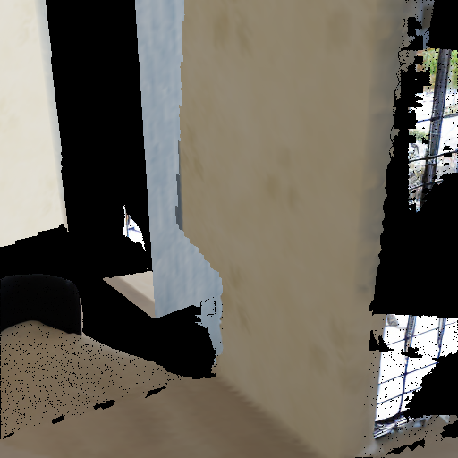

# GenRC perspective pilot v1

2026-10-19. **Execution passed; candidate quality is not suitable for promotion. Owner acceptance is pending.** This is one generated central crop of frame 0037, not a completed room or a reproduction of GenRC's full panorama pipeline.

The owner authorized model acquisition and one bounded generation pilot, then explicitly accepted the reviewed, pinned `sd2-community` mirror after the original endpoint returned HTTP 401. One A100-40GB invocation ran with a 30-minute execution limit, 5-minute startup limit, blocked runtime networking and no automatic retry. No viewer changes or additional generation occurred.

## Inspect

| Input reconstruction | Generated image | Filtered candidate mesh |
| --- | --- | --- |
|  |  |  |

[Full source view 0037](source-0037.jpg) was inspected **after generation**, for review only. It was not supplied as RGB/depth conditioning. The generated grilles and chair-like form contradict this source. The filtered mesh has scattered fragments and substantial remaining holes. Higher pixel coverage does not establish correct structure.

[Views 0036](candidate-0036.png) and [0038](candidate-0038.png) face the cabinet rather than the generated doorway region. They do not demonstrate consistency around the new patch. A future candidate needs small pose offsets around the same patch.

## Measured checks

- 84,967 added triangles; 60,321 candidate triangles rejected by training-depth checks.
- Exact preservation of all 312,015 original vertices, 606,025 original triangles and original vertex colors.
- RGB outside the generation mask remained identical; all 12 output-file hashes verified.
- Independent CPU raycasting in the **512px central crop**: coverage 59.03% before, 75.27% after; 42,577 newly hit pixels. No previously covered pixels became occluded by more than 2cm. This is not the full-frame r03 coverage metric.
- 413 new boundary vertices snapped within the configured 1cm seam allowance; original vertices did not move.
- Worker reconstruction/inference/export interval: 22.25 seconds; peak allocated GPU memory 3,949,120,512 bytes. This excludes some preparation and is not billed duration.
- Modal app `ap-pbsoUqhooPFupMqvg3UCwI`: 23:36:17–23:37:17 EDT, verified stopped with zero tasks. Run `3fc02ab106634fa3a0e2a1cd0c82cf13`, call `fc-01M5BP3B314BRZ6Y8VNBDHNYVX`.
- All 17 local tests and Python compilation passed before the run. The prior plain-JSON return correction also worked in this live invocation.

[Result manifest](result.json), [independent checks](verification.json), [executed source hashes](source-hashes.json). Large PLYs and the original ZIP remain under `.local/reconstruction/genrc-candidate-v1/`; `extracted/candidate/candidate.ply` is the combined mesh, and `completion.ply` contains only additions.

## Model identity and limits

IronDepth checkpoints came from the [publisher-linked Drive folder](https://github.com/baegwangbin/IronDepth). Both Torch archives were checked without deserialization locally; only expected tensor/OrderedDict pickle globals were present. Strict model loads succeeded remotely. Publisher checksums were not available:

- `normal_scannet.pt`: 290,731,303 bytes, SHA-256 `1edf0b1ecce9a8959e005aabbe13de5311793cbfb8164d1a0b36aab52ce01b42`.
- `irondepth_scannet.pt`: 291,341,998 bytes, SHA-256 `7b225677623ea2ad4b1331fceffa3446a060c391537018733e43525f2a97f9f1`.

SD2 came from the explicitly unaffiliated [sd2-community mirror](https://huggingface.co/sd2-community/stable-diffusion-2-inpainting), revision `5f74973cbb64c8568780732c17f43eb269d63a0d`. All selected files matched its published LFS SHA-256 or Git blob SHA-1 metadata. Only safetensors weights and data/configuration files were acquired; no model-repository Python was executed. Equivalence to the inaccessible Stability AI original remains unverified. The downloaded configuration declares no safety-checker component; it was not removed by this adapter.

Sealed cache key: `225acf65a7bac771d229eba9f3ed8a66d32c996bdbb7a3ee653bd5a04cbd08f5`; 5,743,703,953 bytes including manifest, uploaded to `eva-genrc-models-v1`. Model source records, acquisition scripts, download metadata and authorization are in `.local/reconstruction/genrc-acquisition-v1/`. Runtime package inventory is in the candidate ZIP.

Retained [SD2 model license](SD2-LICENSE-MODEL.txt) and [IronDepth repository license](IronDepth-repository-LICENSE.txt). The latter is the repository's MIT notice; checkpoint-specific terms were not separately stated in the inspected listing. Source scene/image attribution: Apple Hypersim, underlying assets by Evermotion, CC BY-SA 3.0. Generated outputs use these source-derived images and the recorded models.

## Decision

Keep this candidate for diagnosis; keep r03 as the displayed room. Successful cloud execution is established, but useful completion is not. A subsequent method should constrain structural infill and protect openings, using available training-view evidence instead of relying on a broad living-room prompt. That is a separate candidate and run, not an automatic retry.

The listed requested-resource baseline was about $1.27 for a full 30-minute execution, before startup/build/storage/actual usage. Actual charges were not retrieved.
