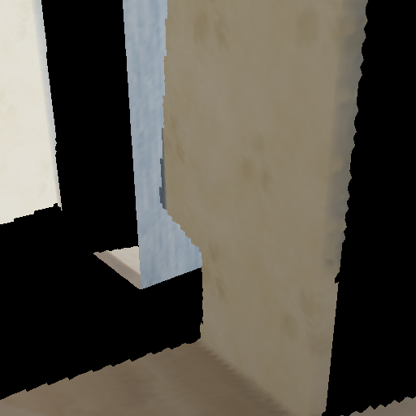
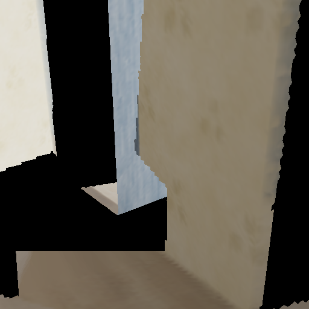
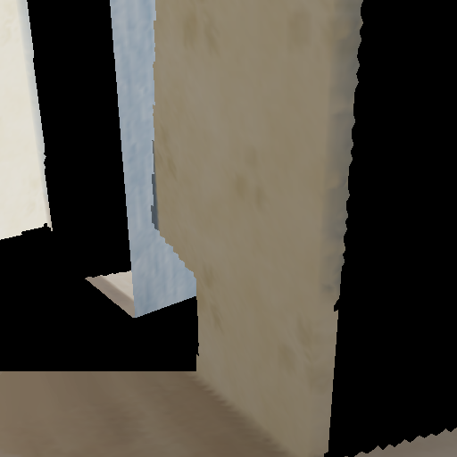
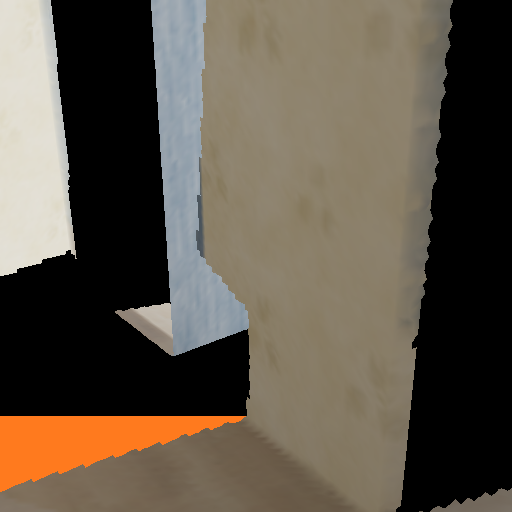

# Geometry-first completion experiments

2026-10-20. **The bounded floor patch is repaired; full-room completion remains unresolved.** No paid generation or cloud compute ran in this pass. These are local supplied-RGBD experiments, not Weave-node outputs or RGB-only reconstruction.

| Original target | Repaired bounded floor |
| --- | --- |
|  |  |

| Camera 10 cm left | Camera 10 cm right | Inferred additions in orange |
| --- | --- | --- |
|  |  |  |

## Approaches actually tested

| Approach | Result | Disposition |
| --- | --- | --- |
| Reproject all 96 full-resolution training RGBD views | 2,020 new image samples; target mesh coverage 59.03% to 59.44% | Retained diagnostic; insufficient to resolve the gap |
| Fit the observed floor and triangulate target samples | Repaired 9,202 / 9,409 requested pixels | Retained v1; tiny tessellation gaps |
| Floor pixel quads | Repaired 9,409 / 9,409 | Retained v2; nearby-view seam pinholes |
| Pixel quads with two-pixel overlap onto supported floor | Repaired 9,409 / 9,409; target known RGB unchanged; nearby seam visibly improved | Recommended bounded candidate v3, pending owner review |
| Extend the same floor across eligible missing rays within room bounds | Coverage 84.47%, but held-out added-depth MAE 22.95 cm and p95 1.55 m; visible material artifacts | Rejected for general completion |

[Source-only render](source-candidate.png), [source measurements](source-report.json), [rejected broad-floor render](rejected-full-floor.png), [broad-floor evaluation](rejected-full-floor-evaluation.json).

## Verified bounded result

The floor height was fitted from 15,167 existing mesh samples, median -0.000046 m and 95th-percentile absolute residual 2.67 mm. New geometry uses that plane; color is an explicitly inferred nearest-floor material continuation. It does not recover the original wood grain.

- Added 20,248 triangles; 715 known target pixels have a narrow overlapping floor surface to avoid seam gaps.
- Every original vertex, triangle and color remains unchanged. Source mesh SHA-256: `10ba765653d9a1fcd9fa587b136038e98d6c01a769d3b38dd3bfc63eca1c7e25`.
- No known target RGB pixels changed. No original target surface was occluded by more than 2 cm. The original browser scene is unchanged.
- All 96 training depth maps checked at full resolution, with 256,356 valid vertex/centroid probes and no rejected triangles. Minimum valid 3x3 source depth handles discontinuities conservatively; tolerance is 5 cm. This is a sampled contradiction test, not proof of correctness.
- After freezing the mesh, held-out frame 0037 depth was used only for evaluation: all 9,409 new pixels had valid references; average depth error **0.874 mm**, p95 **1.698 mm**, maximum **1.969 mm**. Nearest-pixel reference resampling introduces error.
- Overall target coverage is only **62.61%**, up from 59.03%. That denominator is the 512-square central crop, not the full source frame or entire room.
- Seven new tests and 35 existing tests pass. See [test log](tests.txt), [report](report.json), and [evaluation](evaluation.json).

Candidate mesh: `.local/reconstruction/planar-completion-v3/candidate.ply`, SHA-256 `b1ba54d0640de0210dedfd298fe63c263931f6d8da284ac20dbd8f6e500f2552`. Pixel/mesh provenance remains beside it. Earlier candidates are retained under `source-completion-v1`, `planar-completion-v1`, `planar-completion-v2`, and `planar-completion-full-floor-v1`.

## Reproduce

Run from the repository root using the existing local reconstruction environment. Output directories must be new.

```powershell
& .local/reconstruction/venv/Scripts/python.exe scripts/reconstruction/source_completion.py --output .local/reconstruction/source-review --stride 1
& .local/reconstruction/venv/Scripts/python.exe scripts/reconstruction/planar_completion.py --output .local/reconstruction/floor-review --cells --seam-pixels 2
& .local/reconstruction/venv/Scripts/python.exe scripts/reconstruction/evaluate_completion.py .local/reconstruction/floor-review
& .local/reconstruction/venv/Scripts/python.exe -m unittest discover -s scripts/reconstruction -p 'test_*.py' -v
```

The builder never imports the evaluator. Frames 0012/0037/0062/0087 are excluded from conditioning and training-depth checks. Passing evaluation does not make this inferred surface observed evidence.

## Image-stage resolution

`validate_image_edit.py` now checks raw registered RGB before compositing. It rejects aspect changes, invalid masks and excessive outside-mask drift; rejection writes a verdict but no candidate image. A passing image is composited with exact protected pixels and still requires visual/depth review. This is an offline stage, not an integrated Weave graph.

The existing failed Weave image is rejected: **95.82%** of protected pixels exceed an average RGB-channel difference of 8/255, against a 1% limit. See [gate evidence](image-gate.json). Restoring known pixels alone would conceal a wrong-camera image, so it cannot bypass this check.

The owner subsequently approved the 8-credit test using **only the original target image plus its existing mask**, removing both competing reference views. It completed but [failed the raw-image gate](../weave-room-v2/REVIEW.md), returning an almost-black output with a small floor rectangle. No texture was applied; the plane geometry remains unchanged. This does not establish a fix for provider mask semantics or full-room completion.

Next geometry work needs separate wall/opening surface regions and support checks; the failed broad-floor experiment demonstrates why blanket filling is unsuitable. Remaining unknown regions, view-dependent texture quality and full-room visual integration are not resolved by this patch.

Source: public Apple Hypersim `ai_001_004`, underlying scene assets by Evermotion, [CC BY-SA 3.0](https://creativecommons.org/licenses/by-sa/3.0/), [official dataset](https://github.com/apple-aiml-research/ml-hypersim). Changes: RGBD reprojection, inferred plane extension, color transfer and diagnostic rendering.
