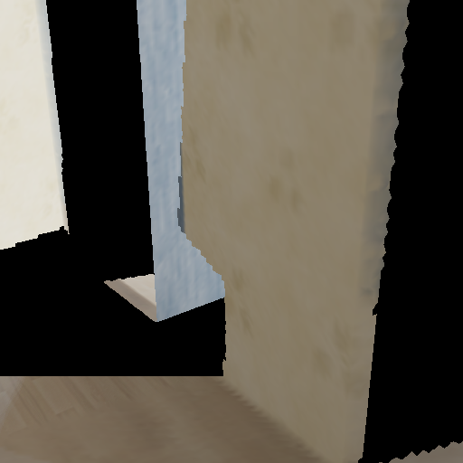
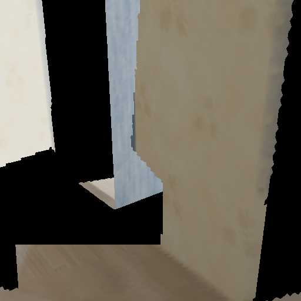
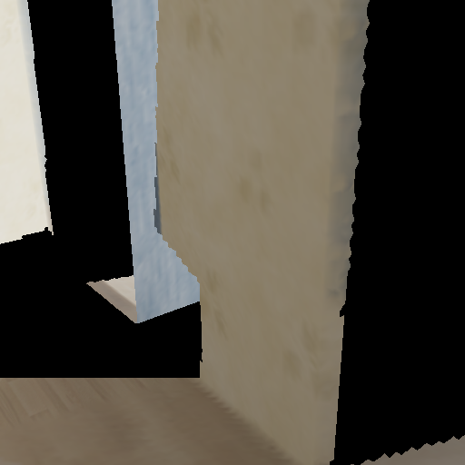
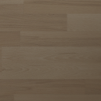

# Independent floor material: implemented candidate

Subsequent room-wide implementation: [full-room-v4 review and evidence](../full-room-v4/REVIEW.md). The record below remains the earlier bounded floor-material experiment.

2026-10-20. The material adapter now works locally without asking an image model to preserve a room camera or mask. This pass extracts a depth-verified material tile from training frame 0005 and maps its detail onto the existing repaired floor. **It is source-derived material reuse over inferred geometry, not generated imagery or recovered appearance at the missing location.**

| Before: nearest-floor color | After: independent material detail |
| --- | --- |
|  |  |

| Camera 10 cm left | Camera 10 cm right |
| --- | --- |
|  |  |

## Actual implementation

[`material_completion.py`](../../../../../scripts/reconstruction/material_completion.py) implements two stages:

1. **Prepare material:** search the 96 allowed training views for a complete 40 cm square floor tile. All 128 x 128 texels must agree with source depth within 8 mm, including the 3x3 depth neighborhood covering bilinear color contributors. Withheld frames 0012/0037/0062/0087 are excluded. An empty search fails instead of filling unsupported texels.
2. **Apply appearance:** map the tile in metric world XY coordinates, using mirrored repeat. Transfer bounded texture detail while retaining the repaired floor's low-frequency color and lighting. Fade detail across a 5–65 mm distance from known floor samples. Preserve overlap-cell colors and all original vertex colors. Export a separate PLY candidate and re-render from three fixed cameras.

Material selection: [training frame 0005](training-source-0005.png), [orthographic tile](material.png), [provenance](material.json). The 40 cm tile is about 2.81 m from the missing patch; its reuse there is an inference. Its projected source footprint spans approximately x399–592, y593–720. Median sampling is 0.88 and 1.23 source pixels per atlas texel along its axes; this does not create additional measured detail.



The source tile visibly contains wood flooring without an object silhouette. Camera-independent mapping keeps its grain attached to the surface. Mirroring can still create repeated or reflected patterns. The candidate adds visible detail to the previously soft patch; whether the blend is aesthetically acceptable remains an owner decision.

## Verification

- Whole candidate **vertices and triangles are identical** before and after material application, including after PLY serialization/reload.
- **Original vertex colors unchanged.**
- **Zero protected target pixels changed**, including the 715 known pixels overlapped by the floor repair.
- Raycast depth is **bit-identical** at the target and both 10 cm lateral offsets.
- The prior floor repair's 9,409 filled pixels and geometry evaluation are therefore unchanged. No new depth model or geometry fitting ran.
- 37,256 added vertices received color detail. The resulting PLY uses sampled vertex colors, not a runtime GPU texture.
- **47 tests pass:** the existing 42 plus five material tests covering visibility/occlusion, bilinear sampling, UV continuity, protected colors, tampering, wrong material origin, unknown manifest fields and withheld-source rejection.
- Repreparing the source tile and reapplying it after provenance validation produced the same material hash and candidate mesh hash as the first local experiment.

[Result report](report.json), [changed-pixel mask](changed-mask.png), [verification](verification.json).

Candidate: `.local/reconstruction/material-completion-v2/candidate.ply`, SHA-256 `fe0eeafff8f9def467bb7f2044fc8df0b3d9617c636c7a1f4cb561d01f562a49`.

Fixed geometry input: `.local/reconstruction/planar-completion-v3/candidate.ply`, SHA-256 `b1ba54d0640de0210dedfd298fe63c263931f6d8da284ac20dbd8f6e500f2552`.

Material preparation inputs, per-texel source coordinates, donor search and output vertex UV/blend provenance are retained under `.local/reconstruction/floor-material-v2/` and `.local/reconstruction/material-completion-v2/`. Earlier candidates remain intact.

## Reproduce

Use fresh output directories:

```powershell
& .local/reconstruction/venv/Scripts/python.exe scripts/reconstruction/material_completion.py prepare --geometry .local/reconstruction/planar-completion-v3 --output .local/reconstruction/material-review-atlas
& .local/reconstruction/venv/Scripts/python.exe scripts/reconstruction/material_completion.py apply --geometry .local/reconstruction/planar-completion-v3 --material .local/reconstruction/material-review-atlas --output .local/reconstruction/material-review-result
& .local/reconstruction/venv/Scripts/python.exe -m unittest discover -s scripts/reconstruction -p 'test_*.py' -v
```

## Scope and limits

This fixes the bounded floor **appearance pipeline** by removing its dependence on masked room-image generation. It does not fix Weave's internal mask behavior. Rejected Weave outputs were not reused.

No new image generation, paid compute, model installation or frontend edit occurred. The existing browser viewer was not switched to this candidate. The broader room still has unresolved holes; overall central-crop coverage remains 62.61%. Native UV textures, a reviewed generated-material import path, and full-room material/geometry completion remain future work.

Source: public [Apple Hypersim](https://github.com/apple-aiml-research/ml-hypersim) `ai_001_004`, underlying scene assets by Evermotion, [CC BY-SA 3.0](https://creativecommons.org/licenses/by-sa/3.0/). Changes: floor-tile rectification, mirrored material reuse, detail transfer and diagnostic rendering.
