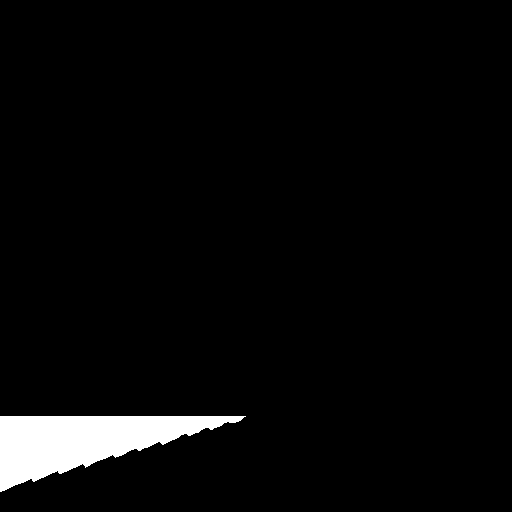
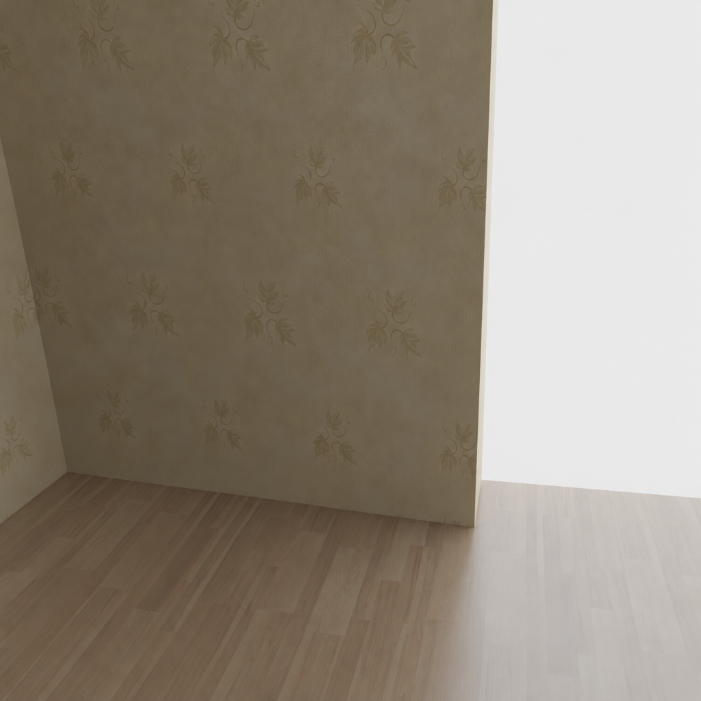

# Weave room image test v1

2026-10-19. **Generation completed; image rejected for geometry because the target camera and mask were not preserved.** No depth extraction, mesh generation, viewer replacement or automatic retry followed.

| Target reconstruction | Allowed edit region (white) | Raw Weave output |
| --- | --- | --- |
|  |  |  |

The image has more coherent wood flooring and wallpaper than the SD2 pilot. However, it resembles the framing of [training reference 0005](train-reference-0005.png), rather than the target reconstruction. The target's blue-gray jamb disappears, and previously black unknown regions outside the small floor mask are filled. The raw output cannot be assigned the target camera and fused into the room.

The output alone does not establish whether the model ignored the mask, the connector interpreted it differently, or reference-image handling caused the composition change. Do not claim a specific API defect without further evidence.

## Executed record

- Owner approval: `Approve — 8 credits`, for one masked floor-repair test with no automatic retry.
- Tool: official Figma Weave `weave_run_model`; GPT Image 2.5, Sunburst, high quality, square HD, opaque PNG.
- Model ID: `2db90e64-51dd-45b2-870a-66d19a81118e`.
- Prediction ID: `14171e1c-6afc-4780-aef7-82de0b86a3df`.
- Provider status: `COMPLETED`; provider-reported charge: **8 Weave credits**.
- Output: **1024×1024**, 1,132,683 bytes, SHA-256 `e043c120a5971537b48428a08c1b6400cfdc54601f65d1a2950c76e39a04b420`.
- The first image was the registered 512×512 target; the other two were training references 0005 and 0035. No withheld RGB/depth entered the request.
- [Exact request settings and asset IDs](../../weave-room-v1-request.json); [prepared input conventions](inputs.json); [measured checks](verification.json).
- Submission and completion responses remain in `.local/reconstruction/weave-room-v1/`. The source reconstruction and viewer remain unchanged.

## Measured mask drift

For analysis only, the raw output was box-downsampled to 512×512. The saved output above is unchanged. Small resampling differences are expected, but these results indicate broad changes:

- Intended editable area: **9,409 pixels**.
- Outside that mask, **95.82%** of pixels changed by more than 8/255 mean absolute RGB intensity.
- Outside-mask mean absolute RGB error: **91.50/255**.
- All **98,004** protected unknown pixels changed beyond that threshold.

These are image-difference checks, not geometric registration or quality scores. Visual inspection independently shows the viewpoint/layout mismatch.

## Next design correction

Before another paid test, enforce image-role and mask behavior. A target-only edit or a tight target crop may reduce full-reference composition transfer; material swatches could provide appearance without a competing camera view. A workflow-level composite should preserve outside-mask pixels, but compositing alone cannot repair a wrong-view patch. Depth and mesh work must wait for a registered image.

The existing [workflow specification](../../WEAVE_COMPLETION.md) remains the plan for extraction and calibration. The map previews in this folder were computed from the original geometry locally; they are not newly executed Weave-node outputs. Full node-chain availability remains unresolved.

Attribution: public synthetic Apple Hypersim `ai_001_004`, underlying assets by Evermotion, CC BY-SA 3.0. Owner acceptance remains pending; lead recommendation is to retain this output as diagnostic evidence only.
