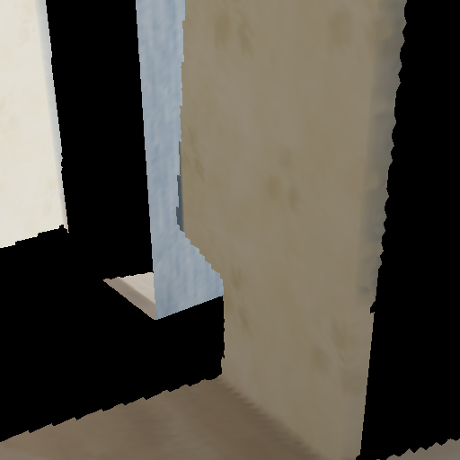
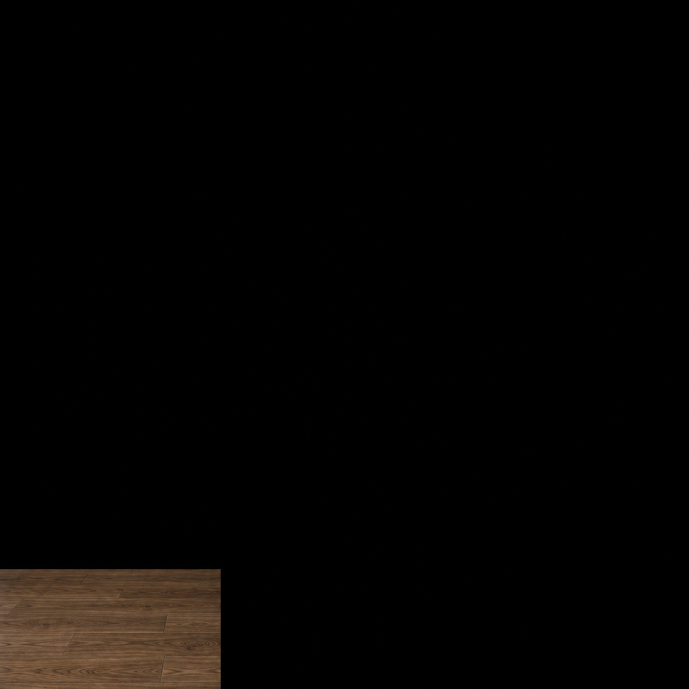

# Weave single-image floor test: rejected

2026-10-20. The owner explicitly approved one **8-credit** GPT Image 2.5 / Sunburst test with only the original target image and floor mask. Prediction `cd0edccc-6dcf-4ba3-b4fa-07ae1ed80586` completed. The provider reported 8 credits charged. No automatic retry, depth generation or mesh modification followed.

| Original target | Returned raw image |
| --- | --- |
|  |  |

[Provider output](https://media.weavy.ai/image/upload/v1792470832/uploads/RjA4KfH9v0eVz56zC2LruMUpYXG2/cwsx28nfhyh1pfoujqdh.png) · [Exact request and asset IDs](../../weave-room-v2-request.json) · [Editable region](edit-mask-white.png)

## What changed

The two competing training reference images from v1 were removed. The original 512-square target, alpha mask, high-quality Sunburst settings and square-HD output were retained. The prompt requested an in-place floor repair only. Geometry was to remain the independently fitted floor plane; the generated image could only supply appearance after passing the raw image gate.

## Actual result

The 1024-square output is almost entirely black, with a small wood-texture rectangle at the bottom left. It removes the room's walls and jamb. It is not a registered room edit or a usable complete floor patch.

- **61.22%** of protected pixels exceed the 8/255 mean-channel change threshold; allowed maximum is 1%.
- Protected-pixel mean absolute RGB error: **79.14 / 255**.
- **95.15%** of known room pixels become near-black (all channels <=8 after box resizing).
- Only **7,086 / 9,409** editable pixels contain nonblack output; this measures color presence, not correct material or registration.
- The gate returns `rejected-no-composite`. No composite texture or textured mesh was emitted.

See [gate result](gate.json) and [verification](verification.json). Output SHA-256: `45f57e9fb9bec08de13bffeddab809e81b4ef23a0513a6d1c5cc0acab5ae5bac`; 339,963 bytes.

## Diagnosis and limits

Both submitted media URLs were downloaded again. The target and alpha-mask files match the original local files **byte for byte and pixel for pixel**, including image dimensions and RGBA alpha. Upload corruption or swapped stored assets is therefore not supported.

The provider's internal mask conversion, input routing and model behavior are not observable through this connector. The output does **not** establish which of those caused the failure. Removing additional reference views was insufficient; do not report a fixed mask pipeline.

Reproduction of the rejection (use a new output directory):

```powershell
& .local/reconstruction/venv/Scripts/python.exe scripts/reconstruction/validate_image_edit.py --original .local/reconstruction/weave-room-v1/input-room.png --raw docs/research/hypersim/evidence/weave-room-v2/output-raw.png --mask .local/reconstruction/weave-room-v1/edit-mask-white.png --output .local/reconstruction/weave-v2-gate-review
```

Expected Python process exit: 2, verdict `rejected-no-composite`, no `candidate-rgb.png`. Existing gate tests and the earlier 42-test run are recorded in the [geometry review](../geometry-completion-v1/REVIEW.md); this pass changed no implementation code.

## Disposition

Retain the [geometry-first floor repair](../geometry-completion-v1/REVIEW.md) as the review candidate. Full-room completion remains unresolved. Do not spend on another repetition of this masked room-edit request.

The next approach to investigate is an independent material-texture asset mapped onto fixed floor geometry, with explicit UV scale, seam blending and generated-color provenance. That avoids making a room image model responsible for camera/layout preservation. It is a proposed route, not implemented or authorized generation. The rejected image has not been silently salvaged as a texture.

Public synthetic input: Apple Hypersim `ai_001_004`, underlying scene assets by Evermotion; [CC BY-SA 3.0](https://creativecommons.org/licenses/by-sa/3.0/), [official dataset](https://github.com/apple-aiml-research/ml-hypersim). Changes: TSDF rendering, bounded mask and model-generated failed edit. No private photographs.
