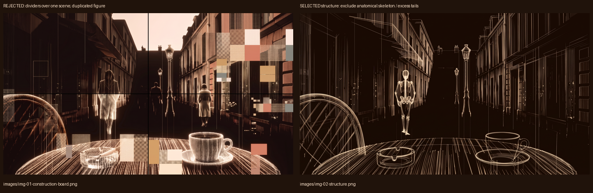

# Seed-33 Rust reconstruction

Status: **candidate 14 implemented and verified by Astra; improved glass, material hierarchy, antialiased highlight spread and rear-figure articulation.** Owner acceptance: pending. Accepted implementation baseline: none. It remains a stylized procedural reconstruction, not an exact reference match.

## Current review entry points

- [Seed-33 versus candidate 14](implementation/after/candidate-14-msaa/comparison.png).
- [24-second construction/living clip](implementation/after/candidate-14-motion/rust-construction-and-living-24s.mp4) · [gait close-up](implementation/after/candidate-14-motion/gait-closeup-12s.mp4) · [tile close-up](implementation/after/candidate-14-motion/tile-closeup-12s.mp4).
- Matching frames: [structure](implementation/after/candidate-14-msaa/structure-1800.png), [base](implementation/after/candidate-14-msaa/base-5700.png), [detail](implementation/after/candidate-14-msaa/detail-9000.png), [formed](implementation/after/candidate-14-msaa/formed-12000.png), [living](implementation/after/candidate-14-msaa/late-22000.png). [Before, candidate 11](implementation/after/resume-verification/formed-12000.png).
- [43 passed browser checks](implementation/after/candidate-14-msaa/checks.json), [performance summary](implementation/after/candidate-14-msaa/summary.json), [resource audit](implementation/candidate-14-resource-audit.json), [127-file source manifest](implementation/candidate-14-source.json), [source/media verification](implementation/candidate-14-verification.json).
- [Continuation brief and internal checkpoints](CONTINUATION.md). Historical recovery/candidate evidence remains below, unchanged.

The original fresh Weave image/video packet and its selected/rejected aspects remain below. This is continuation of its unfinished bounded reconstruction, not a new direction. No additional generation or spending occurred.

## Candidate 14 continuation — 2026-10-10

Owner requested the remaining incomplete work and reaffirmed Astra implementation/integration. Main re-inspected the existing pass's selected still, temporal study and original appearance target before edits; [brief](CONTINUATION.md). No new reference direction or credit allowance was inferred.

Implemented changes:
- **Materials/architecture:** locally varied bead fields, footprint-filtered distant cells, less dominant structural lines after detail, profile-distance bead spacing on vessels, varied façade bay dimensions, jamb strengths and selected shutter slats.
- **Ashtray/lamps:** explicit tubular rims and flutes make the glass readable. Sparse opaque highlight cells with actual discarded gaps replace order-dependent alpha blending; non-refractive glass remains an approximation. Lamp glazing and ornamental caps are separate procedural geometry.
- **Figure:** a rear cloth hood replaces the dark spherical cap; tapered upper/lower limbs, restrained shoulder counter-rotation and body lean supplement the connected stance/swing rig. No cutout, pose-frame playback or source-image torso.
- **Light:** Rust draws the current geometry to bounded four-sample colour/depth attachments, resolves it, and applies a small fixed highlight-spread kernel. All texture contents originate in this frame's Rust draw. Nothing uploads reference pixels or reveals a pre-rendered scene. Candidate 13's single-sample edge regression was caught visually and independently; candidate 14 restores four-sample rendering, verified through actual renderbuffer sample queries.

**Executed checks:** 12 Rust tests (including vessel spacing and tapered-limb regression), 207 app tests, app typecheck/build, **43 production-browser checks**, resource/preservation audit, and **361/361 recording frames** passed. Browser checks add actual 4× colour/depth sampling, target-byte accounting, texture-allocation failure, insufficient sample support and incomplete framebuffer failure; previous image-denial, controls/reduced state, resize/context-restoration and memory checks still pass. Native/WASM dead-code warnings remain. No page errors or scene-image requests occurred in the recording. [Verification report](implementation/candidate-14-verification.json).

**Source:** `e43c7ae` plus dirty tree, 127-file digest `303bf95d2ef8c4a5825fc1c5810852f9513fec38b9a036742dd911403db16062`. All hashes matched after final app checks and recording. Changed code: `renderer/Cargo.toml`, `renderer/src/{gait,geometry,gpu,lib,light,materials,scene}.rs`, `app/src/host/RustStage.tsx` (resource telemetry only), `app/scripts/capture-rust.mjs`, rebuilt WASM/glue. README/evidence/INDEX/acceptance documentation also updated. Historical renderer source/assets remain preserved; no broker, Weeks 1–3, commit or push changes.

**Measured sample:** 864 frames over about six seconds; RAF median/p95 **6.9/7.1ms**, Rust generation/submission CPU median/p95 **4.0/6.5ms**, mean upload **2,380,223 bytes/frame**. WASM memory **19,202,048 bytes**; requested vertex storage **7,340,032 bytes**; requested light-target storage **64,488,960 bytes** at **1920×933**, DPR 1. Full-height 1920×1080 targets request 74,649,600 bytes; the 8MP cap bounds requested light targets to 301,989,888 bytes. These are attachment-size accounting, not driver/total-VRAM measurements. Chrome/ANGLE RTX 5080/D3D11 only; no universal framerate, GPU-duration or native WebView2 claim. Four-sample support is required and fails explicitly if unavailable.

**Motion inspected:** [whole-sequence samples](implementation/after/candidate-14-motion/construction-overview-1s.png), [100ms gait](implementation/after/candidate-14-motion/gait-samples-100ms.png), [500ms tile changes](implementation/after/candidate-14-motion/tile-samples-500ms.png), plus matching stage frames and target comparison. Construction gains strands, surfaces then material detail; the connected figure recedes left behind the chair while localized row-body corruption continues. This was temporal sampling, not full-speed playback. [Unstepped browser recording](implementation/after/candidate-14-motion/realtime/cb5e9c9757c3ede3d8e8d0742c674141.webm) retains a separate 12.073-second observation; the main 24-second clip is fixed-time 15fps capture, not a performance benchmark.

**Limits and next owner test:** glass readability, edge softness and the figure silhouette improve over candidate 11, but the current architecture still has more regular repetition and less directional luminous contrast than Seed-33. The cloth rig remains stylized, not anatomically detailed, and human-looking gait needs full-speed owner judgement. This does not establish exact visual fidelity or acceptance. Run the README's dev command and compare the full construction, away/left gait and reduced-motion state, or watch the linked clips and request specific changes. All step/phase decisions remain pending.

**Actual routing:** main implementation/integration through Model Gateway → Codex **`gpt-6-astra`** (configured `claude-gpt-6-astra[1m]`). Native read-only `eva-reviewer`, configured `opus`, routed through Anthropic **`claude-opus-4-8`**, as observed in this session's route metadata. It inspected GPU/host contracts and candidate-13 light integration; no worker wrote implementation or approved aesthetics. Main verified its MSAA finding and implemented the correction. Its initial RGBA/material-ID misread was corrected against actual shader source. Tools: native Read/Edit/Write/PowerShell/Bash, Cargo/npm, existing Playwright Chrome drivers, FFmpeg; Ruflo routing advice only.

## Scope

Astra main (`claude-gpt-6-astra[1m]`, harness-reported) owns implementation, not Sonnet. Entire fixed-camera Seed-33 scene: Rust-authored geometry, procedural materials, actual component construction, articulated away/left gait, local tile-body corruption and Rust GPU submission. JavaScript remains host/loader only. Historical raster-backed candidates/code/assets are preserved but prohibited in the new runtime path.

Source: `e43c7aedb2690c8b9edc3e2446f1d1f584897a5d` plus pre-existing uncommitted Week 4 changes. No step/phase advancement, camera, voice, desktop effects, commit or push.

## Inspected reference packet and implementation guidance

[Video](references/videos/vid-01-construction-living.mp4) · [500ms overview](references/videos/motion-overview-500ms.png) · [250ms assembly details](references/videos/assembly-samples-250ms.png) · [100ms gait details](references/videos/gait-samples-100ms.png)

Video inspected through those temporal samples, not full-speed playback. Its chair rim gains material ahead of the table/cup, with distinct furniture surface states around 4–5s. **Select that component timing contrast only.** Reject camera drift, photorealistic/conventional end shading, persistent medical skeleton, forward/gliding figure, changed architecture, nearly absent accent corruption and whole-surface blending. Audio is unreviewed and excluded. This generated video is neither a gait exemplar nor a replacement for Seed-33's appearance. It provides inspected temporal study evidence with explicit exclusions; the implementation must not reproduce its mistakes.

Astra inspected both stills, original Seed-33, actual before-frame and the video samples before visual editing. Owned files: new `week4/renderer/` Rust crate; WASM build/loader and Rust host/capture/tests under `week4/app/`; minimal `App.tsx` integration, Week4 Cargo/build manifests and evidence. Historical renderers remain preserved; no worker writes implementation.

Implementation extraction:
- Match original Seed-33 anchors/proportions and deep umber/bone/coral/ochre palette, not the video's widening camera or conventional solid materials. Fixed perspective only, no head-tracking claim.
- Construct table and cup/saucer as curved surfaces, chair as bent frame and intersecting weave, lamps as profiles, architecture as authored relief/facade/window/roof geometry. Never sample any reference pixel into runtime content.
- Rust creates growing strand endpoints and newly submitted surface triangles for per-object structure → form → detail; material detail is stable in local coordinates. Use selected still's open curves but not literal anatomy or excessive vertical tails.
- Near-first staggering follows the selected video timing contrast; start from empty geometry and extend authored anchors, never copy its whole-surface opacity transitions. Default sequence remains 12 seconds and scrubbed from one host clock.
- Figure is an articulated rear-facing clothed rig, alternating stance/swing contacts, leftward/depth trajectory, opposing arms and cloth lag. Reject generated skeleton/forward glide. Judge actual human gait in runtime recordings.
- Accents are independently authored colored geometry: disjoint row bodies, seeded local absence/shear/reconstruction at stable anchors. Tracking rectangles are subordinate; no reference-derived channel fragments.
- Reduced motion selects one fully assembled representative independent of time; no raster or TypeScript fallback. Unsupported backends say unavailable.

## Generated images

- [Selected structural study](references/images/img-02-structure.png): run `918b8e29-3c6d-416e-ac46-c3b2491b40da`, Nano Banana 2.1, separately approved/reported 5 credits. Inspected actual output: table/cup/ashtray curves, chair frame/lattice and facade/lamp anchors retained. Exclude literal anatomical skeleton detail and excessive trailing lines.
- [Rejected board](references/images/img-01-construction-board.png): run `698bb056-8f98-409b-a315-819db18365cc`. It drew dividers across one finished scene and duplicated the near figure instead of four complete construction states. Do not implement those errors.
- Motion run `1cc933ca-5d7d-4292-8d93-cc2700c003d1`: Kling 3.0 Turbo Standard, 10 seconds, 16:9, conditioned on the selected structure; separately approved/reported **90 credits**, submitted once. Output completed and inspected with the limited selection above. Total authorized/reported spend: **100 credits**, no remaining allowance.
- [Historical before-capture report](implementation/before/checks.json): 25 captures, all driver checks passed. [Formed before-frame](implementation/before/webgl2-seed33-build-100pct.png) inspected. These are raster-backed history, not Rust evidence. [106-file pre-edit source manifest](implementation/before-source-manifest.json): `bf86d7f5205d202139b463b7d75ce3521fd14c68c884bc9db2fb1efe3191067d`. First manifest attempt used a nonexistent app-local lock path and wrote no output; corrected to the Week4 workspace lock.

Full exact inputs, approvals and identifiers are in [provenance.json](provenance.json).

- Original appearance anchor inspected: [owner-selected Seed-33](../w4-20261008-paris-c-hybrid/references/images/img-13-bwa3c-seed33.png). It is not fresh evidence and may never supply runtime pixels.

The approved local Seed-33 upload was denied by the shell permission classifier; no retry/bypass. Instead the official Weave output tool recovered the existing hosted output of `9472c515-4ab8-4dbd-bc65-3d52e970e167`; that asset was supplied directly through Weave. The attached-image run was re-quoted at the same approved 5 credits before submission. No token or authenticated URL is retained here.

## Read-only preparation

The native `eva-researcher` (configured Terra; independent transport identity not verified) inspected the current broker/host and official wasm-bindgen documentation with read/search tools. No worker wrote implementation. Ruflo routing was advisory only.

Available locally: Rust/Cargo 1.98.1; installed `wasm32-unknown-unknown` and Windows MSVC targets; Node 24.14.0. `wasm-pack` and `wasm-bindgen` were initially not found on PATH. Installed `wasm-bindgen-cli` pinned to `0.2.128` with `cargo install --locked --jobs 2 --root week4/target/wasm-tools`; the ignored Week4-local executable reports `wasm-bindgen 0.2.128`. No global PATH/config change. `CLAUDE_CODE_SUBAGENT_MODEL` is unset. Tool checks are not evidence of a built renderer.

Proposed transport, subject to dependency/build verification: a separate Rust WASM crate using feature-scoped `web-sys` WebGL2, with Rust owning context/program/buffer lifecycle and draw submission. Do not attach renderer authority to the stage broker. No TypeScript or image fallback may masquerade as Rust.

## Integration constraints from read-only review

Native `eva-reviewer`, configured `opus`, reviewed the bounded host contracts with Read only. Their reported concrete model was self-identification, not verified transport evidence; no concrete observed model is claimed here. No implementation or acceptance review has occurred.

- WASM initialization is async; readiness must remain false through module fetch/instantiation and shader setup, then be tied to an actual intended draw. Denied WASM must produce an explicit unavailable message, never a fake ready blank canvas.
- Keep one host clock. Rust receives bounded time and never owns another requestAnimationFrame/wall-clock accumulator. Fixture `lifeMs` must truthfully mirror the actual draw time, not retain unrelated TS simulation.
- New Rust path must bypass historical TS scene/material construction and the existing auto-Canvas fallback. Unsupported Canvas2D must be labelled unavailable, with no source-image fallback.
- Reduced motion selects a stable complete representative independent of toggle time. Toggles/backend remounts preserve clocks; scrubbing intentionally sets them.
- Context loss removes readiness and reports degradation; restore must rebuild GL resources or explicitly report unavailable. Async completion after unmount must not resurrect a canvas; disposal frees buffers/contexts. Test StrictMode and remount churn.
- Validate inputs again in Rust; cap mesh counts, draw buffers, framebuffer dimensions and WASM memory. Keep the crate free of broker/network/IPC dependencies.
- Negative-image evidence must run at meaningful formed/late times with nonempty geometry counters, blocked image requests and inspected frames. A successful empty t=0 clear does not prove reconstruction.

These are obligations, not executed test results.

## Implementation checkpoints (not owner acceptance)

- Candidate 1: actual Rust/WASM frames rendered while image/movie requests were blocked. [Formed frame](implementation/after/candidate-1/formed-12000.png), [checks](implementation/after/candidate-1/checks.json), [source archive](implementation/after/candidate-1/source.tgz). Rejected internally: broad sky, dim forms, polar-grid tabletop moiré, cup/ashtray placement; reduced pixels differed and context restoration timed out.
- Candidate 2: camera/foreground/material corrections retained in [formed frame](implementation/after/candidate-2/formed-12000.png). Browser evidence still failed reduced comparison and restoration. The reduced captures differed in 652 pixels (out of 1920×933), maximum channel difference 38; not reported as invariant. Console identified stale GL-handle deletion after restoration as the context error.
- Candidate 3: [direct Seed-33 comparison](implementation/after/candidate-3/comparison.png), [formed](implementation/after/candidate-3/formed-12000.png), [structure](implementation/after/candidate-3/structure-1800.png), [base](implementation/after/candidate-3/base-5700.png), [detail](implementation/after/candidate-3/detail-9000.png), [late](implementation/after/candidate-3/late-22000.png), [28 passed browser checks](implementation/after/candidate-3/checks.json), [exact source archive](implementation/source-candidate-3.tgz). Loss now invalidates old GL handles before restoration; identical paused/reduced effective inputs need no re-rasterization. Rust-side reduced geometry invariance is separately unit-tested.
- [Whole construction + 12 living seconds](implementation/after/candidate-3-motion/rust-construction-and-living-24s.mp4), [gait close-up](implementation/after/candidate-3-motion/gait-closeup-12s.mp4), [tile close-up](implementation/after/candidate-3-motion/tile-closeup-12s.mp4), [unstepped browser recording](implementation/after/candidate-3-motion/realtime/58705bab2d858085d1b7295be5c51055.webm), [recording report](implementation/after/candidate-3-motion/recording.json). All 361/361 fixed-time frames completed; no page errors or image requests. This is 15fps authored-time playback, not measured realtime FPS.

Inspection: actual formed/structure frames, direct target comparison, [1s whole-sequence samples](implementation/after/candidate-3-motion/construction-overview-1s.png) and [100ms gait samples](implementation/after/candidate-3-motion/gait-samples-100ms.png). No full-speed playback claim. Objects visibly gain structural segments, surfaces and bead detail; figure poses alternate and recede left behind the chair; colored row bodies continue changing. The rigid torso, shoe shape, regular facade repetition and uniform/dense material treatment remain fidelity concerns. Human-looking gait and exact reference fidelity are not established by the joint tests or these limited samples.

Executed technical evidence so far: 8 new Rust tests, 207 existing app tests, WASM build and app typecheck; candidate 3's 28 browser checks cover image blocking/nonempty actual frames, time/visibility/reduced state, unsupported Canvas2D, denied WASM/GPU, context loss/restoration, resize and repeated reseeding. Six-second unrecorded browser sample: 865 rendered frames sampled, RAF interval median 6.9ms / p95 7.0ms, Rust generation/submission wall time median 4.8ms / p95 5.5ms, WASM memory ≤18,481,152 bytes. Device reports Chrome ANGLE / NVIDIA RTX 5080 / D3D11. These are browser measurements, not GPU duration or native WebView2 evidence. Recording materially adds capture overhead (the separate video's report includes ~34ms submit samples); do not infer recording performance from the unrecorded sample.

Runtime inventory and reproducible commands: [renderer README](../../../../renderer/README.md). Further visual refinement and independent review remain in progress.

### Later checkpoint corrections

- Candidate 4 added facade/roof/material and joint refinements, but its new interrupted-step test exposed queued time being replayed after loss. Clearing the rejected queued step fixed it; candidate 5 passed all 33 production-browser checks.
- The first compiled-resource audit found dormant `background.png` / `figure-away.png` strings in the production JavaScript, despite no fetched/bundled images. The historical host was moved intact to `HistoricalApp.tsx` and isolated behind a development-only lazy import. [Candidate 6 audit](implementation/candidate-6-resource-audit.json) passed: no scene images or historical image paths in the build, real Rust GPU imports, 100 baseline files unchanged, and the historical host byte-identical after normalizing its export name.
- Canonical `scene:paris-1980s-terrace` identity was retained separately from the `rust-wasm` renderer label. Steam now derives from the actual cup/rim anchor. Its first new test incorrectly used the maximum of all cup vertices (including a slightly taller handle); the corrected test uses the constructed rim/profile strands, without widening tolerance.
- A stale generated binding caused `TS2339: Property 'inventory' does not exist on type 'RustRenderer'` during an intermediate check. `pretypecheck` now builds matching WASM/glue first; subsequent app checks passed.
- Candidate 8's latest unrecorded sample had frame p95 **41.7ms** and submit p95 **40.8ms**, slower than earlier samples. It remains preserved; no steady-60fps claim is based on cherry-picking an earlier run.
- Candidate 9 caches settled **geometry buffers, not pixels**, and updates bounded dynamic buffers. [Pixel comparison to candidate 8](implementation/after/candidate-9-production/pixel-comparison-to-8.json): structure identical; the other full-size frames differed in 90–224 pixels of 2,073,600 (mean absolute channel difference ≤0.000198 on 0–255 channels). Tiny raster differences are disclosed, not called bit-identical.
- Candidate 10 passed 38 checks including keyboard focus and forced allocation failure during context restoration. Its six-second sample: frame median/p95 6.9/7.0ms; submission median/p95 3.3/3.7ms; mean uploaded bytes ~2.085MB/frame, requested vertex-buffer storage 7,340,032 bytes; WASM memory 18,415,616 bytes. This measured **1920×933 canvas with controls visible**, not the full-height recording viewport. These are single browser samples, not a native or universal performance guarantee.
- Final gait refinement: visual close-ups showed over-bent stance knees despite passing bone-length constraints. The planted-foot interval is now centered about the advancing pelvis, the stance height/bob is adjusted, arm motion opposes the leg cycle, and body weight shift follows the supporting side. The stance test now checks its intended knee-bend bound as well as fixed contacts/segment lengths. Final captures are being verified separately rather than relabeling an earlier recording.

All earlier captures/recordings remain in their immutable candidate folders. Final owner acceptance is still pending.

## Independent review disposition

The same read-only `eva-reviewer` (`opus` configured; concrete transport unverified) reviewed candidate 3 source, without running checks or judging aesthetic acceptance. Main verified their reports before acting:

- **Fixed:** an undrawn lost-context frame could consume host/manual time and leave its promise pending until the event. Main now rolls time back, rejects that step promptly and handles a mid-submit context-loss result. The new driver exercises a step interrupted by loss and verifies restoration at the prior clock.
- **Small preventive correction:** projection originally duplicated an equal aspect constant in Rust and GLSL. The fixed shader now receives the trusted Rust constant through its source template, with a unit check. There was no observed distortion from the old equal constants.
- **Not a crate/CLI mismatch:** `renderer/Cargo.toml` already pins `wasm-bindgen = "=0.2.128"`, and the build uses `--locked`; the CLI checks that same version. The reviewer did not inspect this manifest. No mismatch was observed.
- **Not private identifying data:** the captured GPU model/API is the generic platform information explicitly required by DESIGN.md's evidence manifest, not a serial number, account, device identifier or private screenshot. It is retained as hardware provenance; nothing is published or committed by this task.
- **Readiness limitation documented:** `data-ready` means the module/context/program completed the requested draw, which can intentionally be empty at t=0. The negative-image checks separately require actual nonempty framebuffer pixels and geometry at five nonzero stage times. Readiness alone is not reconstruction evidence.

Main also tightened the manual hook to one awaited request (explicit rejection rather than silently coalescing concurrent requests), and disabled the historical-look choice in production where its assets are intentionally excluded. These changes remain under the same scoped packet and require the subsequent capture/check run.

## Recovery verification — 2026-10-10

The interrupted session had completed candidate 11's gait correction, 38 browser checks and 361-frame recording, but had not finished this handoff. Earlier sections describe historical checkpoints, not the latest status.

**Source binding:** [before](implementation/resume-source-before.json) and [after](implementation/resume-source-after.json) manifests contain 126 identical source/test/runtime/build files, digest `5b4c42330f4a087cf0111d62214ffcb810b8024d8b55c2716432969e399d7b07`. Every hash still matched after recording. This binds the fresh recovery evidence, not retrospectively the older candidate-11 media. [Verification and media hashes](implementation/resume-verification.json).

Executed in recovery:
- `cargo test --manifest-path week4/Cargo.toml -p eva-seed33-renderer`: **11 passed**. Native dead-code warnings remain because the GPU entry point is WASM-only; no test failures.
- `npm --prefix week4/app run check`: **207 app tests, typecheck and production build passed**. The app tests include retained historical paths and are not, alone, proof of Rust rendering. WASM build emitted two dead-code warnings.
- `node week4/app/scripts/capture-rust.mjs <new-absolute-directory> 1463 --production`: **38 passed**, no page errors. Covers actual nonempty Rust frames with images denied, actively enforced historical-image denial, controls, keyboard focus, reduced pixels, unsupported backend, WASM/GPU failure, loss/restoration including interrupted manual steps and allocation failure, resize and remount memory.
- [Compiled/preservation audit](implementation/resume-resource-audit.json): **passed**; no bundled scene images or historical image-path strings, actual Rust GPU imports, 100 baseline files unchanged, six expected integration files changed. The historical host body is preserved after normalizing its renamed export.
- Capture/record script syntax and `git diff --check`: **passed**; Git reported line-ending normalization warnings only.

### Source-bound motion

[24-second construction and living recording](implementation/after/resume-motion/rust-construction-and-living-24s.mp4) · [unstepped browser recording](implementation/after/resume-motion/realtime/2fa0b6267dc43657d0a693cca5832c73.webm) · [recording report](implementation/after/resume-motion/recording.json)

`node week4/app/scripts/record-rust.mjs <new-absolute-directory> 1464 --production` completed **361/361 frames**, with no page errors or blocked media requests. The first clip is 15fps fixed-time capture of 12 seconds of construction plus 12 living seconds, not a realtime performance claim. The separate unstepped run retained 12.055 seconds of browser observation, including startup in its video.

Main inspected the [1-second construction overview](implementation/after/resume-motion/construction-overview-1s.png), [100ms gait samples](implementation/after/resume-motion/gait-samples-100ms.png), [500ms tile samples](implementation/after/resume-motion/tile-samples-500ms.png), matching stage frames and original comparison. Inspection is temporal sampling, **not full-speed playback**. Structural arcs precede surfaces/detail; the near figure alternates articulated poses and moves left behind the chair; accent rows change locally. These observations do not establish naturalistic gait or exact reference fidelity.

### Measurements and visual limitations

Fresh six-second unrecorded sample: **865 frames**, RAF median/p95 **6.9/7.0ms**, Rust generation/submission CPU wall time median/p95 **3.3/3.8ms**, mean upload **2,085,309 bytes/frame**, WASM memory **18,415,616 bytes**, requested vertex-buffer storage **7,340,032 bytes**. Chrome/ANGLE, NVIDIA RTX 5080, Direct3D11; **1920×933 canvas**, DPR 1, within a 1920×1080 viewport with controls. Not GPU duration, native WebView2, a full-height recording measurement or a universal performance guarantee. Preserve the earlier slower candidate-8 result above.

[Matched recovery versus candidate-11 pixels](implementation/after/resume-verification/pixel-comparison-to-11.json): structure is identical; base/detail/formed/late differ in 7/113/14/16 pixels out of 2,073,600 respectively. Maximum individual channel difference is 41/255; no bit-identical claim for those frames and no proven cause attributed to the differences.

**Still incomplete:** the target's soft luminous material/lighting and irregular architecture are not matched; façade and tabletop patterns remain too regular/dense, the ashtray loses contrast against the detailed table, and the stylized coat/head/limbs remain less natural than the target. Glass is an authored approximation without refraction. Human-looking gait requires full-speed owner review. This is a functional procedural candidate, **not a finished exact reconstruction or a phase-ready visual claim**. Native/WebView2 and broader Week 4 work were not run or advanced. Independent source review covered candidate 3 only; the recovery researcher did not perform a final code or aesthetic approval.

### Handoff and next owner exercise

Main recovery route: Model Gateway metadata for session `419700b9-044b-490e-996c-403b8df15157` records Codex `gpt-6-astra`; native read-only `eva-researcher` records Codex `gpt-5.6-terra`. Tools: native Agent, Ruflo advisory `hooks_route`, Read/Glob/Grep, PowerShell/Bash, local Chrome via existing Playwright drivers, Cargo/npm and FFmpeg. No Sonnet implementation worker was launched. No source edits, new generation/spend, commit, push or phase decision occurred in recovery.

Recovery changed this REVIEW, its provenance, the phase INDEX and acceptance record, plus new immutable evidence/manifests. Existing Rust implementation ownership and file inventory are documented in the [renderer README](../../../../renderer/README.md).

Run `npm --prefix week4/app run dev`, then open `http://127.0.0.1:1440/?fixture=1&look=seed33&seed=33&build=12000`. Compare the 12-second construction, subsequent away/left walk and accent breakup to the target; test pause, time scrub, tiles and reduced motion. Use the linked clips without launching if preferred. **Next feedback is on the remaining fidelity gaps; no step/phase acceptance is inferred or requested as already satisfied.**
