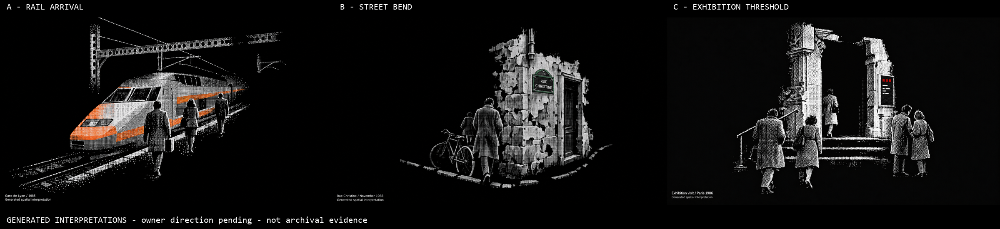

# Cohesive Paris scene studies

**Three stills completed and inspected; owner likes B as the direction but requests less detail/density and more Parisian objects. No motion or implementation.** Date: 2026-10-14. Source revision: `565b5ad6c4b62cf903cf903288941ce8f95850ff`, branch `week4`. Accepted baseline: none.

## Compare the actual outputs

[Open side-by-side comparison](references/contact-sheet.png) — generated interpretations, not archival evidence.

| Full-resolution original | Composition result | Main limitation |
| --- | --- | --- |
| [A — Rail arrival](references/images/img-a-rail-arrival.png) | Train, three figures, rails and overhead structure share a strong receding diagonal; people overlap the train rather than occupying separate islands | Cab/body and silhouettes are too complete; orange covers broad livery areas rather than only tiny interrupted patches |
| [B — Street bend](references/images/img-b-street-bend.png) | Plaque attached to a wall corner; doorway, bicycle and overlapping walkers establish one compact human-scale place | Wall/door/bicycle remain substantially outlined and surfaced; the plaque is visually oversized relative to the figures |
| [C — Exhibition threshold](references/images/img-c-exhibition-threshold.png) | Five figures converge on one doorway or pause beside it; stair edges and handrail establish spatial relationships | Architectural columns and clothing read as complete illustrated forms; texture is more fine stipple than coarse ordered dithering |

**Recommendation for discussion: B**, because the physical relationships create a street scene without filling an enclosing street. A has the strongest depth; C has the clearest social grouping. This is the author's assessment, not a selected implementation reference or owner acceptance. None fully achieves the intended near-shapeless incompleteness.

## Owner correction and response

> It feels like a collection of items rather than one cohesive experience/scene. Try a few different direction and scenes for generation.

This supersedes the pending composition question in [r1](../w4-20261014-paris-source-particles-r1/REVIEW.md); that output stays unchanged and is not selected. These are three distinct spatial episodes rather than rearrangements of detached train/plaque/poster specimens. Three was the author's bounded interpretation of “a few”; the owner subsequently approved each exact 34-credit run separately.

## Actual visual inspection

Main opened each original PNG and the labeled comparison using Read. The originals are unmodified 3840×2160 PNGs; the contact sheet is a resized 2400×550 comparison, not a replacement source.

- **Cohesion:** all three visibly improve shared perspective, scale relationships and overlap. They do not scatter unrelated source tokens into separate quadrants. This is qualitative inspection, not a measured cohesion score.
- **A:** three figures recede along the train and rail/platform edges; gantry members overlap in projection. The near figure has a bag. The train is still almost a complete locomotive-shaped form with detailed windows and broad orange patches. Generated train geometry is not verified as a faithful TGV53 model. Rails run close to the lower-left boundary, and a wire reaches the top edge. This is not proof of movement or a documented arrival.
- **B:** the bicycle, near walker, farther figure, wall corner and attached plaque are spatially related. The wall has holes and broken outer edges, but the masonry and doorway remain extensively surfaced. The bicycle is more complete than the requested broken arcs. The generic clothing, facade and plaque scale are not historically validated. This is a scene hypothesis, not a reconstruction of Rue Christine's surrounding geometry.
- **C:** five visitors are visible, including a figure crossing the doorway and a pair at right. The information surface contains red marks and white bars; no portrait or pseudo-archival artwork is visible. The generated architecture is more ornamented than requested. The red marks are block-like rather than three horizontal header bars. The stonework and figures remain relatively complete. A faint nonuniform dark background is visible, rather than rigorously flat black.
- **Material:** A/B show stronger repeated square-cell patterns than r1, while C remains more stippled. All retain overly legible/complete surfaces and bodies. Exact cell size, accent percentage, silhouette coverage, font identity and requested coordinates were not quantitatively verified.
- **Boundaries:** no continuous filled street floor, complete enclosing environment, dashboard or source-window collage is visible. These are static illustrations: no hover, click, particle construction, native windows, source retrieval or performance is demonstrated.

Keep every original, including defects. No automatic corrective run is authorized.

## Historical anchors versus authored scenes

The [existing source collection](../w4-20261014-paris-source-particles-r1/ARCHIVE.md) remains separate from these generated concepts. No archive media or local references were uploaded.

| Direction / exact prompt | Supported anchor | Authored additions, not historical evidence |
| --- | --- | --- |
| [A prompt](prompts/a-rail-arrival.txt) | Phil Richards's TGV53 photograph at Gare de Lyon, 2 August 1985; visible orange/grey train, rails, overhead wires/gantries | Arrival event, figures, bag, platform arrangement; no movement, route, speed or passenger claim |
| [B prompt](prompts/b-street-bend.txt) | Esther Westerveld's Rue Christine plaque photograph, November 1988; stone, wall edge and upper pipe | Bend, doorway, bicycle, walkers, clothing and surrounding spatial geometry |
| [C prompt](prompts/c-exhibition-threshold.txt) | Gilles Huot's poster documenting the Petit Palais exhibition, 6 February–20 April 1986 | Entrance architecture, visitors, placement and abstract information surface; not a poster reproduction |

The three source records do not establish a shared location/time or represent all Paris life. Generated captions and shapes do not verify historical authenticity. Factual interface text must later be rebuilt from verified strings.

## Spend and execution

Installed official Figma Weave direct-model route; catalog `gpt-image-2.5`, tool ID `2db90e64-51dd-45b2-870a-66d19a81118e`. Each used Sunburst/max, custom 3840×2160, opaque PNG, text only; no source images, masks or uploads.

| Candidate | Actual quote / structured approval / tool-reported cost | Completed prediction ID |
| --- | --- | --- |
| A | 34 / Approve / 34 credits | `2fd438ae-91c8-4842-9c4c-0e7153d0e6da` |
| B | 34 / Approve / 34 credits | `2f972b78-233e-468e-a990-623a14a368bd` |
| C | 34 / Approve / 34 credits | `918c999a-340b-4a75-b36d-43ecbe7cfae7` |

**Total for this pass: 102 Weave workspace credits. Further paid allowance: zero.** One paid submission per candidate; no automatic retry, substitute provider, boundary frame or video run.

Initial preparation encountered a quote-only permission denial (`[Real-World Transactions]`). After the owner explicitly said “I approve all quote requests,” the same official route returned all three quotes. Quote approval was not treated as spending approval: a three-question AskUserQuestion presented each price separately, and the owner selected Approve for each before submission. No permission settings were changed or bypassed.

[Provenance](provenance.json) and [media/prompt hashes](media-manifest.json) retain the exact local records; hosted output URLs are not needed in the packet.

## Review provenance and checks

Main owns prompting, execution, inspection and documentation integration. Native `eva-researcher` independently reviewed the archive/owner context and visually inspected all three archival originals using Read/Glob, with no edits or new web research. Their source/authored distinction and portrait-risk warning informed the prompts; this was not an independent review of the generated outputs.

Configured identities: main `claude-gpt-6-astra[1m]`; native researcher `claude-gpt-5.6-terra[1m]`. Independent transport attribution was not reverified for this pass. Ruflo `hooks_route` was advisory; the native Agent performed the actual research review.

Originals were downloaded into separate isolated scratch directories, copied byte-for-byte into the packet, and inspected. The labeled comparison was built with existing FFmpeg; no tooling was installed. See provenance for focused verification results. No application source or runtime behavior changed; application tests were not run for this reference-only pass.

## Owner direction feedback — 2026-10-14

The owner likes Scene B but finds it too detailed and particle-dense, requests more Parisian objects, and then asks for three directions using newly attached photos for composition only—not style. This is a direction preference with changes required, not acceptance of the finished material or authorization for implementation. The [photo-conditioned sparse studies](../w4-20261014-paris-sparse-photo-scenes-r3/REVIEW.md) preserve this feedback and the separate upload/spending approvals.

## Historical next-owner-gate proposal

Review A/B/C for the direction of the cohesive experience, separately from the remaining density/incompleteness defects. Nothing is selected by default. If a direction is selected, scope corrections and separately quote needed boundary frames and motion. The eventual construction remains **one continuous 30–45s four-stage video**, with synthetic desktop/source arrival and final hover/click studies outside that duration as needed.

`references/videos/` and `implementation/before/` / `implementation/after/` remain empty. No real applications were minimized, no private desktop captured, and no commit, push, publication, camera/voice/ML infrastructure or phase advancement occurred. The image-plus-motion implementation prerequisite remains incomplete.
