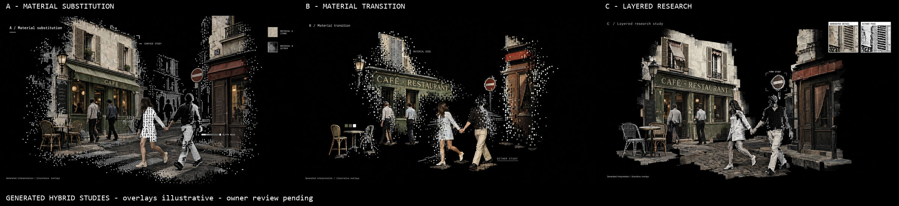

# Hybrid crossing studies

**Three new versions of Direction B completed and inspected; owner loves C most and requests abstracted main surfaces with separate detail panes. No motion or implementation.** Started 2026-10-14, completed 2026-10-15. Source HEAD `565b5ad6c4b62cf903cf903288941ce8f95850ff`, branch `week4`. No finished accepted baseline.

## View the results

[Open comparison](references/contact-sheet.png).

| Original 3840×2160 output | Strongest result | Main limitation |
| --- | --- | --- |
| [A — Material substitution](references/images/img-a-material-substitution.png) | Most explicit collage of realistic stone/furniture, glyph-filled clothing and dithered bodies; small swatches and a surface-study bracket | Rebuilds extensive facades and connected pavement; invents address **62** and menu-like lettering, not historical evidence |
| [B — Material transition](references/images/img-b-material-transition.png) | Best balance of open black gaps, realistic fragments, square-cell breakup and small labels | Furniture becomes more isolated; some bodies and sign lettering remain quite complete/realistic |
| [C — Layered research study](references/images/img-c-layered-research.png) | Clearest process presentation: generated-detail/dither panes and a form-study bracket, integrated with mixed-material figures | Ground becomes a near-continuous slab and buildings are over-complete; panes sit side-by-side rather than overlapping |

**Discussion recommendation:** C communicates the proposed research presentation most clearly; B better preserves the open, fragmented scene. None is selected automatically. Generated realistic regions, menu/address details and inset crops are not authentic archive evidence.

## Owner direction and scope

The owner really likes [r3 B](../w4-20261014-paris-sparse-photo-scenes-r3/references/images/img-b-street-crossing.png), but finds it too simplistic and requests three new versions combining realism, dithering and a few overlays, informed by six images and a new video.

This authorizes a hybrid-material/collage exploration for these stills, refining the earlier all-dither visual constraint. It does **not** authorize a flattened photo/video runtime, generated code, a return to the old Seed-33 implementation, app edits, actual ML infrastructure or any phase advancement. Rust procedural construction and bounded runtime data remain unchanged. How realistic fragments would be represented at runtime requires a later explicit implementation scope decision.

## Actual output inspection

Main opened each original PNG and the labeled comparison with Read. Originals are unmodified; comparison is a resized 2400×550 derivative.

- All retain the broad crossing composition: left café/storefront, upper shutters, right doorway/sign, crossing pair and smaller figures, furniture left. None literally preserves every source coordinate or scale.
- Unlike r3's uniform dotted contours, all contain realistically shaded material alongside black/white dither surfaces and sparse edge cells. Their realism is generated/reinterpreted, not a documented historical reconstruction.
- **A:** glyph treatment is clearly visible as letter-shapes on one foreground torso, with realistic sleeve/legs; the other foreground figure uses dither patches. Two material swatches and a shutter crop bracket are legible. Larger architecture/paving masses make the scene denser and more corridor-like than requested. The invented “62” plaque, café/menu writing and detailed clothing have no validated historical meaning.
- **B:** shutter, storefront, clothing and furniture break into discrete cells and a few horizontal streaks. The open field and isolated foot-contact patches better preserve incompleteness. The table/chairs feel less spatially connected to the storefront, and realistic people remain highly legible. Streaks do not demonstrate real motion or optical flow. The source's café/restaurant wording has been re-rendered, not preserved as verified text.
- **C:** the two upper-right panes read “GENERATED DETAIL” and “DITHER PASS”; the sign has a “FORM STUDY” corner bracket. These communicate an editorial comparison without confidence numbers. They are synthesized pane contents, not real source retrieval, linked views or native windows. Facades and joined paving are too extensive; the pane overlap requested in the prompt is absent.
- All carry a generated-interpretation/illustrative-overlay footer. No fake error/security message, numerical confidence or live-analysis claim was observed. Labels, fonts, ratios, overlay area, material percentages and historical fidelity were not quantitatively verified.
- No real person was identified. Conditioning can preserve source poses, clothing and appearance cues; these outputs do not establish participant identities or the invented scene's date/place.

## Input roles and permissions

The owner explicitly approved uploading images 6–11 and reusing the already-hosted r3 B plus original street photo4. Each run used four inputs: generated B as composition; photo4 for realistic material/composition cues; and two new style references. No other local media was uploaded. The video and sampled frames stayed local.

| Version / exact prompt | Style inputs and inspected mechanism |
| --- | --- |
| [A prompt](prompts/a-material-substitution.txt) | [7](inputs/style-7.png): glyph-shaped person mask inside realistic surroundings; [11](inputs/style-11.png): different figure materials over a street. Saturated masks were not adopted |
| [B prompt](prompts/b-material-transition.txt) | [6](inputs/style-6.png): dither silhouette overlaps a realistic image boundary; [9](inputs/style-9.png): realistic subject with localized white-particle breakup |
| [C prompt](prompts/c-layered-research.txt) | [8](inputs/style-8.png): halftone surface retaining object form; [10](inputs/style-10.png): silhouette/rectangle contrast over realistic scenery. Glow/detection implications were not adopted as factual claims |

[Input manifest](inputs-manifest.json) records retained files, hashes, stable asset IDs, roles and exact quote/paid bindings. Photo4 and r3 B remain in their existing packet rather than duplicate copies. Creators, dates, original URLs and broader reuse rights of the new owner attachments/video are unverified. They are creative references, not evidence of 1980s Paris. No public publication was authorized; do not publish the inputs or this packet. Upload tokens and hosted input URLs are omitted from repository records.

## Local video inspection

The supplied `From Klickpin.com- Healthy Breakfast Ideas 61 Ideas to Copy-pin-id-999095498641347187.mp4` is **720×1280, 60fps, 8.746009s**, with an AAC audio stream. Filename subject does not describe its actual footage.

- [250ms temporal samples](local-inspection/video-samples.png); native-size frames at [0.5s](local-inspection/video-0.5s.png), [3.5s](local-inspection/video-3.5s.png), [6.5s](local-inspection/video-6.5s.png); [metadata and preservation hash](local-inspection/video-record.json).
- Observed: several street/architectural shots with perspective-layered panels, object rectangles, fine trajectory-like marks, localized halftone/pixel substitutions, typography and blue/white error-window graphics. A horse/street segment includes a target-like label; other shots include large white/blue substitutions and a streetlamp transformation.
- Borrowed for still planning: local object-specific changes and small layered comparison elements. Not adopted: fake system errors, warning/authority language, numerical pseudo-telemetry, neon blue or a full enclosing first-person street.
- **Limit:** temporal sampling and three stills only, not full-speed playback or audio assessment. Timing, flashing, transitions and precise tracking cannot be certified. Source video is unchanged and was not uploaded. These local samples are not new Weave motion references and do not satisfy the motion-generation gate.

## Execution, cost and review provenance

Official Figma Weave direct `gpt-image-2.5` image-conditioned route, model tool ID `2db90e64-51dd-45b2-870a-66d19a81118e`; Sunburst/max, 3840×2160 opaque PNG, four inputs per run, no mask. Each quote was **34 workspace credits**, shown and individually approved through AskUserQuestion before its single paid submission.

| A | B | C |
| --- | --- | --- |
| `f7aba780-ffd3-4827-896d-0b2796055336` | `400d42f5-3a19-42f6-91a3-9fb5fa0548fb` | `63477cf2-86c7-4d44-b30e-a4e3ca6f0515` |

**102 credits this pass; further allowance zero.** All runs completed. No model reruns, automatic retries, video generation or provider substitution. [Provenance](provenance.json) and [media manifest](media-manifest.json) retain settings, inspection and checks.

Main configured `claude-gpt-6-astra[1m]` performed video inspection, authoring, uploads/generation, output review and integration. Native `eva-researcher`, configured `claude-gpt-5.6-terra[1m]`, used Read/Glob/Grep to synthesize the six style images and prior B; no edits or new video/output review. Their observed mechanisms informed the material variants. Main did not adopt their full-photographic-plate suggestion or treat editorial boxes as actual detection. Independent transport attribution was not reverified; Ruflo routing was advisory only.

## Owner follow-up — 2026-10-15

The owner loves C most and explicitly requests three further versions **based on C**, abstracting the main pavement/façade with image12 while separate overlays show detailed tile/façade studies. C is the preferred direction to refine, not a final implementation acceptance. See the [C-based surface refinements](../w4-20261015-c-abstract-surfaces-r5/REVIEW.md) for separately approved input upload, runs and actual outputs.

## Historical next gate and limits

Owner composition/material review of the three actual outputs. The accepted direction preference is not acceptance of these new versions or a working implementation. Future research views must preserve genuine source images and verified metadata separately from generated scene fragments; these study panes are not substitutes for that source system.

No app code changed; no app tests run. No tooling installed, permission changes, commits, push, public publishing, real-window minimization, desktop capture or camera/voice/ML work. Original and prior media are preserved. `references/videos/` and `implementation/before/` / `implementation/after/` remain empty. The separately scoped continuous 30–45s four-stage motion requirement and owner gates still block implementation.
