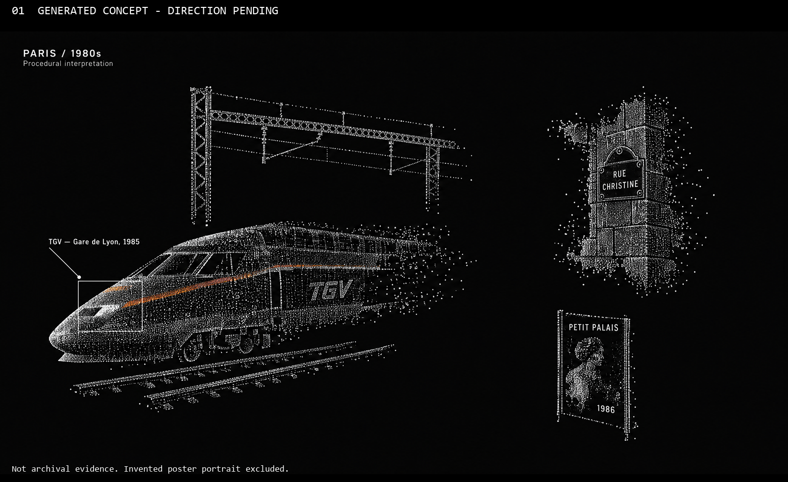

# Paris source-to-particle direction

**First composition still generated and inspected; owner requests different, more cohesive scenes (2026-10-14). Not selected. No motion generation or application implementation.** Authoring date: 2026-10-14 (local). Source HEAD: `565b5ad6c4b62cf903cf903288941ce8f95850ff`, branch `week4`. Accepted baseline: none. Every implementation/study gate remains pending.

## Review the actual candidate

- **[Open the full 3840×2160 still](references/images/img-01-paris-source-particles.png)** — GPT Image 2.5, Sunburst, quality=max. Generated illustration, **not archival evidence or working software**.
- [Labeled contact sheet](references/contact-sheet.png).
- Selection: **for owner composition discussion only**. Not selected as an implementation-ready reference. No automatic follow-on run.
- Known factual defect: the model invented a portrait inside the poster despite an explicit exclusion. It is not the real 1986 poster and must not be reused as a historical document.

## What this attempt proposes

A partial train and rail fragment at lower left; an overhead gantry above it; a detached wall corner with the Rue Christine plaque at upper right; a small poster-shaped object below. Large black gaps separate the local relationships rather than completing a street corridor. White points carry the forms; the orange accent comes from the photographed train livery. These objects combine different sites and dates intentionally, not a claim about one historical location or instant.

**Owner question:** does this object arrangement and empty-space distribution approach the intended desktop experience, or is the train-led selection/composition itself wrong? Material defects below can be separated from that decision. No composition approval is inferred from the 34-credit spending approval.

## Actual inspection, not prompt compliance assumed

Main inspected the full generated PNG and labeled contact sheet with Read.

- Present: distinct recognizable objects, rail/gantry relationship, partial wall, large gaps, no enclosing street/continuous ground/photo background, restrained orange stripe and a nose-attached rectangle.
- **Incomplete contours:** the train and gantry remain substantially more fully outlined than requested. The train reads as a large near-complete point shell, not a sparse set of disconnected surfaces. Its scale and position differ from the supplied coordinate ranges.
- **Texture gap:** fine stippling/point-cloud shading dominates; the horse/cow references have coarser binary dither patterns and larger internal regions. Do not claim reference-style fidelity.
- **Invented content:** portrait inside the poster; extra TGV lettering beyond the short requested labels. Neither generated text nor body details establish exact train-model authenticity. Rebuild factual annotation text from the source records later.
- **Interaction gap:** the white mark is a leader/dot, not a demonstrated moving cursor. A single image cannot establish hover density change, click pinning, attached tracking during motion or native windows.
- **Surface/layout gap:** the poster remains an almost rectangular plane; wall block outlines are more complete than requested; the background contains low-contrast texture rather than a rigorously flat field. Numerical point coverage/accent-area targets were not measured.

Keep the original unchanged, including defects. No corrective generation or image editing is authorized by this review.

## Authentic sources — separate from generated concepts

[ARCHIVE.md](ARCHIVE.md) records three retrieved, pixel-inspected originals, creator/date/location evidence, credits and explicit reuse markings:

1. [TGV 53 at Gare de Lyon, 2 August 1985](archive/images/tgv53-1985.jpg), Phil Richards, Commons CC BY-SA 2.0 record; current Flickr record links 4.0 (difference disclosed).
2. [Rue Christine plaque, November 1988](archive/images/rue-christine-1988.jpg), Esther Westerveld, CC BY 2.0; use month precision rather than an uncorroborated exact day.
3. [Petit Palais Rembrandt exhibition poster, 1986](archive/images/petit-palais-rembrandt-1986.jpg), Gilles Huot, institution's CC0-marked download; bundled item credit and all three pages of its use guide inspected and retained.

Four restricted museum-photo records remain metadata-only research, not adopted assets. The initial research suggestion to turn 60 superimposed passenger portraits into a carriage of exactly 60 people was rejected after main checked the catalogue description. No broad historical inference or licensing clearance is manufactured from a record title. The selected collection is narrow, not representative of all 1980s Paris.

## Direction, prompts and provenance

- [Recovered original owner wording](OWNER_CONTEXT.md), not merely the corrupted handoff.
- [Bounded brief and four-stage timing proposal](BRIEF.md).
- [Model capabilities and staged generation plan](GENERATION.md).
- [Exact submitted still prompt](still-01-prompt.txt), [run/settings/approval record](provenance.json), [media hashes and request checks](media-manifest.json).
- Local-video sheets: [layered windows](local-inspection/winter-samples.png), [horse](local-inspection/horse-samples.png), [cow](local-inspection/animal-samples.png); native details: [8s windows](local-inspection/winter-detail-8s.png), [2s horse](local-inspection/horse-detail-2s.png), [2s cow](local-inspection/animal-detail-2s.png). These are local extracts of supplied media, not Weave candidates; no redistribution rights established.

## Spend and execution

Official Figma Weave direct-model route. Model tool ID `2db90e64-51dd-45b2-870a-66d19a81118e`, model ID `gpt-image-2.5`, Sunburst/max, custom 3840×2160, opaque PNG, text only. Actual quote: **34 Weave workspace credits**. Owner selected structured **Approve** for this one still. Submitted exactly once with acknowledgedCost=34; run `66b4b180-9cf6-49af-b618-879bd0c55026` completed. Tool reported cost34; output dimensions locally confirmed. **Further allowance: zero.** No uploads, boundary frames, videos, retries or duplicate submissions.

Configured/observed routes: main `claude-gpt-6-astra[1m]` → Codex `gpt-6-astra`; native `eva-researcher` `claude-gpt-5.6-terra[1m]` → Codex `gpt-5.6-terra`; native `eva-reviewer` `opus` → Anthropic `claude-opus-4-8`. Session-linked route events at 2026-10-14T23:35:41.203Z / 23:36:29.638Z / 23:36:38.801Z, session `fc92b156-6c68-4a36-a0cf-5c85d708f023`. No subagent-model override. Ruflo hooks_route advisory only; workers actually launched via native Agent. Researcher used Read/WebSearch/WebFetch for sources; reviewer used Glob/Grep/Read for original context. Main performed media inspection, source/rights follow-up, generation and all documentation integration. Workers changed no files.

## Checks and limitations

- Verified branch/full HEAD and starting dirty state: only three supplied MP4s. Originals remain hash-identical after extraction.
- Actual media dimensions/hashes recorded. Exact prompt file matches the paid tool request; one paid submission and requested settings confirmed from this session's tool records.
- **Passed:** 36 local Markdown links/new pointers, three original-video hashes, eight media/prompt hashes, provenance JSON parsing and `git diff --check` (existing LF/CRLF warning only). Exact submitted prompt/settings and single paid submission also passed. No application source changed, no app/native captures or performance measurements made; unrelated app tests were not run.
- Local videos inspected at 1s / 250ms sample intervals plus native-size stills, **not full-speed playback or audio**. Generated still cannot establish motion.
- Restricted Marais-photo browser screenshot failed with `Page.captureScreenshot timed out`; no retry, permission/config change or image-inspection claim. The open-use selected images were successfully downloaded and directly inspected instead.
- Figma identity lookup/catalog and actual paid still run succeed; no independently identified Weave workspace name or general credit allowance is inferred.
- No real application minimization, private desktop capture, installs, camera/voice/ML infrastructure, commit, push, publication or phase advancement.

Historical [candidate19](../w4-20261012-seed33-rust-fidelity-r5/REVIEW.md) and its [formed capture](../w4-20261012-seed33-rust-fidelity-r5/implementation/after/candidate-19/formed-12000.png) remain preserved; the capture was inspected as historical evidence, not taken anew or adopted as the new target. Do not continue the old café fidelity backlog.

## Owner feedback — 2026-10-14

> It feels like a collection of items rather than one cohesive experience/scene. Try a few different direction and scenes for generation.

Composition changes requested; no selection or acceptance. The next [three-scene preparation](../w4-20261014-paris-cohesive-scenes-r2/REVIEW.md) uses shared perspective, overlap and physical relationships rather than isolated source objects. Its first quote-only call was permission-blocked; no new spending occurred. Original r1 media and the historical inspection record remain unchanged.

## Historical next-gate proposal (before this feedback)

Owner composition feedback first. If the direction is selected, scope the needed corrections/boundary frames and quote each proposed paid run separately. Then generate and inspect the synthetic desktop arrival, window-to-particle transfer, one continuous **30–45s four-stage construction**, and final hover/click clips. Seedance 2.5 currently exposes first/last-frame inputs and up to30s; support is not a continuity guarantee. Retain failed joins and never substitute generated video playback for the Rust renderer. `references/videos/` and `implementation/before|after/` are empty; **the image+motion prerequisite for implementation is not complete**.
