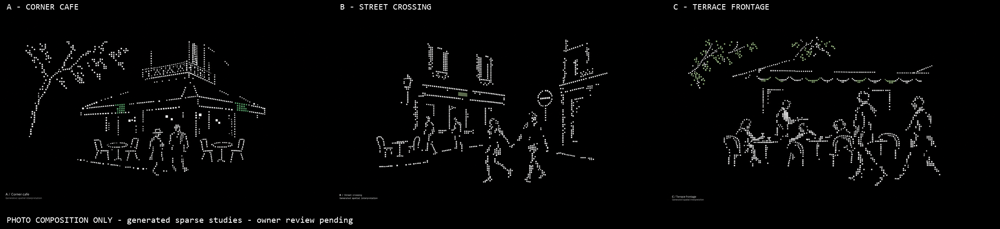

# Sparse Paris photo-composition studies

**Three photo-conditioned stills completed and inspected; owner really likes B but requests richer realism/dither collage and overlays. No motion or implementation.** Source revision: `565b5ad6c4b62cf903cf903288941ce8f95850ff`, branch `week4`. Authoring date: 2026-10-14. Prior direction: r2 Scene B liked, with abstraction/density changes required; no finished visual or phase accepted.

## View the alternatives

[Open the comparison](references/contact-sheet.png).

| Full-resolution output | Composition carried from supplied photo | Inspection result |
| --- | --- | --- |
| [A — Corner café](references/images/img-a-corner-cafe.png) | Wrapping corner awning, two foreground figures, terrace seating, balcony and tree | Most direct continuation of the connected corner idea. Much less surface detail, but awning/balcony and furniture read as dotted outlines; tree/balcony can still read as detached fragments |
| [B — Street crossing](references/images/img-b-street-crossing.png) | Offset storefronts/shutters, circular sign, crossing pair and farther figures | Strongest diagonal movement implied by poses; fully hollow bodies and pixel-outline facades, with an added streetlamp. More pictogram-like than dithered partial surfaces |
| [C — Terrace frontage](references/images/img-c-terrace-frontage.png) | Side-on awning, seated figures, server, passing figures, chairs and foliage | Most varied social arrangement. Still predominantly contour drawing; green extends into foliage rather than remaining only in the two requested awning patches |

**Assessment:** A is the most promising composition to discuss for the selected corner direction. All three reduce visible density, but none is a clean solution to the intended dithered partial-surface material: the model has shifted toward regular dotted contour drawings. Do not treat sparse pixels alone as style fidelity. No r3 reference is selected automatically.

## Controlling owner feedback

> I like Scene B, but its way too detailed, it should be more abstract and less concentrated in terms of particles. Add more objects that's more Parisian, like these real photos attached.

> Try three different directions, now with these images acting as scene composition (not style reference, still stick to that dithering/matrix abstract style).

This selects [r2 B](../w4-20261014-paris-cohesive-scenes-r2/references/images/img-b-street-bend.png) as a direction to refine, not its detail level or implementation. The three new café/street hypotheses do not revive the old Seed-33 first-person café, continuous surfaces or brown/bone style. Spatial relationships come from the new attachments; black/white matrix/dither abstraction remains the target.

## Inputs and permissions

The owner explicitly selected **Approve photo uploads** for three distinct attachments, composition-only inputs to official Weave, with separate cost approval still required. Attachments 2 and 3 are byte-identical; only 2 was uploaded. Originals and exact prompts are retained locally:

| Input | Inspected composition | Prompt |
| --- | --- | --- |
| [Attachment 2](inputs/a-corner-cafe.png), 517×638 | Corner café, awning across two faces, terrace furniture, central standing pair, balconies and tree | [A prompt](prompts/a-corner-cafe.txt) |
| [Attachment 4](inputs/b-street-crossing.png), 403×496 | Offset storefronts, shuttered windows, crossing pair, sign and deeper figures | [B prompt](prompts/b-street-crossing.txt) |
| [Attachment 5](inputs/c-terrace-frontage.png), 403×496 | Awning, café seating/service and passersby viewed from the side | [C prompt](prompts/c-terrace-frontage.txt) |

Photos were visually available in the owner's message. Creator, capture date, original source URL and broader reuse rights are **unverified**. These are owner-provided composition references, not newly verified Paris-1980s archive evidence. No claim about the photographed people's identities is made. The earlier [sourced collection](../w4-20261014-paris-source-particles-r1/ARCHIVE.md) remains separate and unchanged.

The owner authorized these uploads, not public publication or unrelated reuse. Do not publish this packet or its inputs. No other local video, archive original, desktop image or prior generated candidate was uploaded. [Input manifest](inputs-manifest.json) records hashes, asset IDs, roles, omitted duplicate and exact request binding; upload tokens are not retained in the repository.

## Actual output inspection

Main inspected all three original PNGs and the contact sheet with Read. Each output is 3840×2160, unchanged; the comparison is a 2400×550 resized derivative.

- Dense masonry, facades and fabric shading are absent. No source-photo texture or realistic face is visibly retained; this is visual inspection, not pixel-forensic proof that no source pixels were reused.
- All three have large gaps and fewer visible marks, but too many marks follow almost complete object contours. The requested small, broken dithered surface patches largely became regular point-outline drawings. Contour preservation is especially apparent in chairs, awnings and people.
- A retains the two tables/four chairs/foreground pair and a small green accent. Balcony ornament is more explicit than the requested few fragments, and the tree has extended dotted branches.
- B retains the crossing-pair relationship, distant figures, windows and table/chairs. The circular sign is a fairly complete recognizable outline rather than two sparse arcs. An additional streetlamp was generated. Sparse facade edges still imply opposing buildings, but no filled floor or complete enclosing street is visible.
- C retains seated/standing/passing relationships, but adds a scalloped awning edge, broadens green into leaves, and leaves many furniture/body contours largely traceable. Exact requested object counts, positions and cell sizes are not established as compliant.
- No copied business lettering, portrait, historical poster or photorealistic surrounding environment is visible. Tiny generated captions are illustrative text; font identity is not verified.
- These are static design references, not native windows, live geometry, interactions, particle trajectories, measured historical reconstruction or functioning software.

### Density check — raster proxy, not particle count

[Coverage measurements](coverage-metrics.json) decode full original PNGs to RGB24 with existing FFmpeg. A visible-pixel proxy counts pixels where `max(R,G,B)>32` on the 0–255 scale, including captions. No resizing is used.

| Image | Pixels above threshold | Exactly black pixels |
| --- | ---: | ---: |
| Previous r2 B | 10.62% | 58.07% |
| New A | 2.67% | 72.33% |
| New B | 2.65% | 74.16% |
| New C | 3.17% | 71.77% |

Visible-pixel coverage is substantially lower. This is **not** a measured particle count, local concentration, 3D surface occupancy or perceptual-style score. The prompt's 88–93% *pure* black target was not met, despite the images appearing mostly black: low-level nonzero pixels remain. No numerical target is silently relabeled as achieved.

## Weave execution and spending

Official Figma Weave direct model, catalog `gpt-image-2.5`, model tool ID `2db90e64-51dd-45b2-870a-66d19a81118e`. Live contract rediscovery confirmed that supplying images selects the edit endpoint. Each request used exactly one approved photo, Sunburst/max, custom 3840×2160, opaque PNG, no mask. Composition-only use was requested in each prompt; it is not a separate guaranteed model control.

| Output | Quote / structured approval / reported cost | Completed prediction ID |
| --- | --- | --- |
| A | 34 / Approve / 34 Weave credits | `8068b912-d121-4c04-abd6-4951c3780c3b` |
| B | 34 / Approve / 34 Weave credits | `3edeea58-b5bc-4fc8-bfe4-c57e46f19908` |
| C | 34 / Approve / 34 Weave credits | `e4e77db2-f82e-4539-85ef-0be49b0fd923` |

**102 credits for this pass; further paid allowance zero.** Each quote was shown and separately approved through AskUserQuestion before its single paid submission. Prior approval of quote requests was not reused as spending approval. No duplicate generation, retry, provider substitution or video run.

[Provenance](provenance.json), [media/prompt hashes](media-manifest.json) and [input bindings](inputs-manifest.json) preserve the execution record. Uploaded photo URLs and transient upload tokens are omitted from repo records; stable asset IDs identify conditioning inputs.

## Verification and limitations

Main session configured as `claude-gpt-6-astra[1m]`; no new worker was needed for this bounded visual refinement. Ruflo routing was advisory. Independent transport identity was not reverified. Existing FFmpeg/Node were used; no tooling installed.

Initial request-binding validation failed because it compared JSON property order. Diagnosis confirmed semantic equality; the check was corrected to deep object equality, then passed for all three quote/paid pairs. This was a local validation correction, not a model rerun. See provenance for final focused checks.

Original inputs/outputs and all prior references are preserved. No app source changed; app tests were not run for this reference-only pass. No public publishing, commits, permission changes, real application minimization, desktop capture or phase advancement occurred.

## Owner feedback and follow-up

The owner really likes Direction B but finds it too simplistic and requests three new versions combining realism, dithering and a few research-process overlays using six new images and a supplied video. This retains B's composition as the preferred direction, not its final material or implementation. The [hybrid crossing studies](../w4-20261014-paris-hybrid-crossing-r4/REVIEW.md) record the new inputs, separate permissions and inspected outputs.

## Historical next-gate proposal

Owner review of these actual three compositions and the contour-versus-dither trade-off. Any further generation requires its own exact quote and approval. The earlier Scene B direction selection does not accept these new outputs, their style, motion or implementation. Motion still requires one continuous 30–45s four-stage construction plus separately scoped arrival/interaction studies. Video and implementation folders remain empty; application UI work remains blocked.
