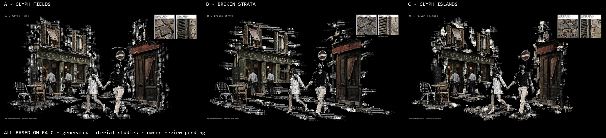

# C abstract-surface refinements

**Three C-based stills completed and inspected; owner review pending. No implementation or motion generation.** Date: 2026-10-15. Source HEAD `565b5ad6c4b62cf903cf903288941ce8f95850ff`, branch `week4`. Preferred direction: r4 C, with surface/pane changes requested; no finished implementation baseline accepted.

## Compare actual outputs

[Open comparison](references/contact-sheet.png).

| Full-resolution original | Visible treatment | Limitations |
| --- | --- | --- |
| [A — Glyph fields](references/images/img-a-glyph-fields.png) | Rows of small circles/triangles/character-like marks replace broad wall areas and much of the ground; black channels break up the paving | Storefront, upper shutters and right doorway remain relatively detailed; inherited sign bracket remains rather than only the two requested material brackets |
| [B — Broken strata](references/images/img-b-broken-strata.png) | Strongest horizontal line/glyph bands, separated wall ribbons and broken ground strips | **Wrong overlay attachment:** the road-sign bracket is labeled “PAVEMENT DETAIL.” Do not reuse this label binding. Main storefront/door remain realistic |
| [C — Glyph islands](references/images/img-c-glyph-islands.png) | More irregular patches and larger glyph clusters; distinct empty gaps around ground fragments | Some realistic paving strips persist; several wall patches still follow rectangular architecture; storefront/door remain detailed |

**Recommendation for review: A**, as the most balanced continuation of the selected C. B makes the new line texture most explicit, but its mislabeled sign is a defect. This is an author recommendation, not a selected r5 reference or owner acceptance.

All three retain C's crossing pair, farther figures, table/chairs, café/window arrangement, right doorway/sign and upper-right panes in broadly corresponding positions. Exact geometry or pixel-identical figure preservation is not claimed.

## Owner request

> I love C the most. But just like you said, try to make the pavement and facade more abstract, maybe use something like this image [Image #12], and have the overlays show a more detailed look of the tile and/or facade separately. Try 3 different versions again.

> Based on C

The base is [r4 C](../w4-20261014-paris-hybrid-crossing-r4/references/images/img-c-layered-research.png), not an earlier B or a new street composition. The bounded change targets main wall/ground material and pane contents while retaining C's established arrangement and realistic/dithered figures. Direction preference does not accept a working implementation, motion or this new pass.

## Inputs and actual generation

- [Image12, unchanged](inputs/style-12.png): 1200×1735. Observed texture: aligned rows of circles, triangles, character-like marks and horizontal rules with density changes. Used as a surface mechanism, not scene content or a cream-background palette.
- Hosted r4 C reused as the composition base. No re-upload or duplicate local copy of that base.
- Owner explicitly selected **Approve image input** for image12 upload and C reuse. Only this one new image was uploaded. No video, desktop or other local media upload.
- Input creator/date/reuse rights are unverified. No public publication authorized. [Input manifest](inputs-manifest.json) records exact roles, hashes, asset ID and quote/paid binding; upload tokens and hosted URLs are omitted from repository records.

Official Figma Weave image-conditioned direct route: `gpt-image-2.5`, tool ID `2db90e64-51dd-45b2-870a-66d19a81118e`; Sunburst/max, 3840×2160 opaque PNG, two inputs per run, no mask.

| Prompt | Quote / structured approval / reported cost | Completed run |
| --- | --- | --- |
| [A prompt](prompts/a-glyph-fields.txt) | 34 / Approve / 34 | `5a00a733-536d-4fbd-a154-90888250a236` |
| [B prompt](prompts/b-broken-strata.txt) | 34 / Approve / 34 | `ed1a42bb-db2b-4ccb-89b6-6c4e3c6bac13` |
| [C prompt](prompts/c-glyph-islands.txt) | 34 / Approve / 34 | `0c833ac3-90ac-494f-aa09-b6e0d28edb59` |

**102 Weave workspace credits this pass; further allowance zero.** Each quote was shown and separately approved through AskUserQuestion. One paid submission per candidate, no retries or provider substitution. Original outputs remain unchanged. [Provenance](provenance.json); [media hashes](media-manifest.json).

## Actual inspection and detail-pane limits

Main inspected all three original PNGs and the 2400×550 labeled comparison with Read. Every original is 3840×2160.

- Ground is visibly more interrupted and glyph-based than the broad paving slab in r4 C. Broad masonry regions have been replaced by symbols/voids, rather than simply adding a dither border. However, realistic storefronts, door panels and shutter assemblies remain extensive; the prompt's numerical surface-replacement target was not measured or certified.
- All three have **different** upper-right close-ups: pavement stone/joints and façade/shutter texture. Both panes visibly carry “Generated study.” They are more detailed than the corresponding abstract wall/ground treatment and are not duplicate shutter views.
- The pane images were generated as part of each still. They are not actual archival crops, live magnifiers, measured material samples or guaranteed matches to a particular physical tile. Their relationship is illustrative; later runtime detail views must bind to the right object and source data explicitly.
- B incorrectly places a pavement label on the road sign. A retains the earlier form-study sign bracket and adds another architectural bracket. C includes ground/upper-wall corner marks, but exact label/anchor compliance is not established. No automatic correction or hidden image edit was performed.
- Glyph-like numbers are decorative texture, not telemetry. No real ML analysis, confidence measurements, native windows, interaction or construction sequence is demonstrated. Existing generated signage/menu-like writing remains illustrative, not historical fact.
- Exact cell size, font identity, black-area ratio, surface-replacement percentage, crop correspondence and unchanged figure geometry were not quantitatively tested.

## Provenance, checks and next gate

Main configured `claude-gpt-6-astra[1m]` handled this tightly scoped authoring pass inline; no new worker or independently verified transport attribution. Ruflo routing was advisory. Existing FFmpeg/Node built the comparison and verified data; no tooling installed.

See provenance for executed focused checks. Preserve r1–r4 and all supplied images/videos. No app source changed; no app tests run. No commit, push, publication, permission change, real-window manipulation, desktop capture, camera/voice or new ML infrastructure.

Owner review of the three actual refinements is next. No r5 selection inferred. Any new generation requires its own quote and approval. Video and implementation folders remain empty. The separate continuous 30–45s four-stage motion requirement and existing owner gates still block UI implementation. This image exploration does not authorize raster/video runtime playback or change Rust/bounded-data architecture.
