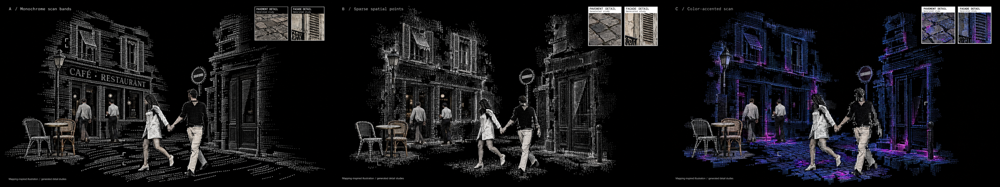

# C mapping-surface studies — recovered r6

**Three Weave stills completed before the terminal API interruption; inspected and packaged here on 2026-10-15. Owner prefers C with changes: minimal mapping colors, r5 A foreground/colors, and overlapping material styles.** Source HEAD `565b5ad6c4b62cf903cf903288941ce8f95850ff`, branch `week4`. Preferred composition: r4 C; accepted implementation baseline: none. This is a reference-only pass.

## Compare the actual outputs

[Open the comparison](references/contact-sheet.png). Left to right: A, B, C. Originals are unchanged 3840×2160 PNGs; the comparison contains proportional 800×450 copies.

| Original | Visible result | Remaining mismatch |
| --- | --- | --- |
| [A — Monochrome scan bands](references/images/img-a-monochrome-bands.png) | Repeated white point rows describe the walls, shutters, door and ground. The ground has clear gaps between bands. People and furniture retain contrasting material. | Architecture is still densely and almost completely described; café lettering and door edges remain strongly outlined. Some warm interior detail persists. |
| [B — Sparse spatial points](references/images/img-b-spatial-points.png) | Irregular point patches replace the broad walls and pavement; larger ground gaps separate the café furniture, crossing pair and doorway. | Window frames, shutters and door are still highly legible and dense; café interior material remains. Several wall regions read as fine stipple rather than sparse depth samples. |
| [C — Color-accented scan](references/images/img-c-color-scan.png) | Blue/violet wall samples and magenta patches most directly recall image13's palette. The main composition remains recognizable. | Broad solid-looking cobblestone texture remains beneath colored samples. Color also reaches the detail panes, and the crossing pair is more fragmented. This does not meet the requested point-only ground treatment. |

**Recommendation for discussion: B** for the requested partial surface coverage and open ground; **A** if scan-band structure matters most. C is useful as a palette study, with the paving defect retained explicitly. This recommendation is not an owner selection or acceptance.

## Recovered request and inputs

Owner, 2026-10-15:

> Can you create another three versions that look like SLAM / LiDAR Point Cloud Mapping. [Image #13] for the pavement and facade.

The transcript's proposed scope kept r4 C as the base, with three alternatives: scan bands, sparse points, and a color-accented scan. The owner then selected **Approve image input** for image13 upload and hosted C reuse, followed by a separate **Approve** for each 34-credit run. No r5 selection was inferred.

- **Composition base:** [r4 C](../w4-20261014-paris-hybrid-crossing-r4/references/images/img-c-layered-research.png). Retain the oblique view, crossing pair, two farther figures, café furniture, two architectural fragments and two upper-right panes. Its broad wall and paving materials are the replacement targets.
- **Style input:** [image13](inputs/style-13.png), 640×480. Visible curved point rows, incomplete building samples and blue/violet/magenta patches inform sampling; exclude its car, aerial viewpoint, trees and enclosing scan-ring composition. A/B use monochrome; C explores its colors. The supplied image is not independently verified as an actual sensor output.
- Image13's creator, date and reuse rights remain unverified. No new upload or publication occurred during recovery. [Input manifest](inputs-manifest.json) preserves the original local hashes, input roles and asset ID.

## Inspection and limits

The recovering main agent opened image13, the r4 C base, all three output PNGs and the comparison using `view_image`. The tool displayed each full scene downsampled to 2048×1152; this supports whole-scene qualitative inspection, not a pixel-level audit of the 4K originals.

All three retain the broad arrangement and object relationships. Their changed dither patterns and figure edges mean exact geometry or pixel-identical preservation is not established. A/B replace much more of the original solid main architecture than r5, but complete-looking door/window boundaries and some café interior detail persist. C's retained paving is a visible prompt failure.

Both upper-right panes contain distinct pavement and façade studies and visible “Generated study” labels. C adds scan colors to both close-ups. These are generated material illustrations, not authentic source photographs, measured reconstructions, linked live magnifiers or verified crops of the main surfaces. The pane headers identify their contents; exact correspondence between crop brackets and sampled objects is unverified.

These are mapping-inspired illustrations. No SLAM, LiDAR, depth reconstruction, sensor measurement or ML inference was executed for this pass. Colors do not encode depth or confidence. The outputs provide no evidence of animation, source retrieval, independent desktop windows, hover/click behavior or runtime performance. Font identity, coverage ratios, point sizes and unchanged figure geometry were not quantitatively verified.

## Execution and recovered spending evidence

Original route: official Figma Weave direct model, catalog `gpt-image-2.5`, tool ID `2db90e64-51dd-45b2-870a-66d19a81118e`; `Sunburst`, quality `max`, custom 3840×2160, opaque PNG, two image inputs, no mask or explicit seed.

| Prompt | Quote / approval / reported cost | Completed prediction |
| --- | --- | --- |
| [A](prompts/a-monochrome-bands.txt) | 34 / Approve / 34 credits | `a3a6e29c-e52a-4108-b7a0-6a6c826bcaeb` |
| [B](prompts/b-spatial-points.txt) | 34 / Approve / 34 credits | `cfc236c2-8fe8-43de-a703-5447681657c0` |
| [C](prompts/c-color-scan.txt) | 34 / Approve / 34 credits | `a551c59e-7bbc-4557-8fa6-81b18aa38758` |

**102 Weave workspace credits were spent in the original session; recovery spent zero. Further allowance: zero.** One paid submission per candidate. Completion was recovered from the saved tool responses, not re-polled or regenerated. No credit balance is asserted as current.

The local Claude Code session `fc92b156-6c68-4a36-a0cf-5c85d708f023` records the substantive request at 05:37 UTC, upload approval at 05:43 UTC, all three cost approvals at 05:52 UTC and completed outputs by 05:56 UTC. Original assistant messages report `claude-gpt-6-astra`; upstream provider/transport attribution was not independently verified. The last output-image read is followed by interruption/API-error/resume messages. There is no later aesthetic selection in that recovered sequence. The API error's underlying cause has not been diagnosed.

Recovery here used Codex tools to read the local transcript, inspect images, create the comparison with existing FFmpeg, and finish documentation. A separate read-only Codex recovery audit checked run/input/file integrity; it is not an aesthetic approval or a claim that an unavailable project specialist ran. Exact recovery model identity is not asserted. Private transcript contents, upload tokens and hosted URLs are excluded from this packet.

## Checks, handoff and next review

[Provenance](provenance.json) records the recovery and checks. [Media manifest](media-manifest.json) binds local input, prompt, output and comparison bytes. [Recovery checks](recovery-checks.json) records the focused verification results. No application tests were run: no application source changed.

Scenario: compare three static surface treatments against r4 C and image13. Generation resolution: 3840×2160; seed unspecified. Browser/WebView/GPU/driver, display DPI, reduced-motion/intensity, runtime input/audio, score/schema, event trace and performance measurements are not applicable to this reference-only recovery. `references/videos/` and `implementation/before/` / `implementation/after/` are empty: no implementation before/after or motion evidence is claimed.

The original next checkpoint was owner comparison of A/B/C; the feedback below now supplies that direction. The separate continuous 30–45-second four-stage motion requirement remains outstanding, alongside the current implementation and acceptance gates. This packet does not authorize generated raster/video playback as the final Rust scene. No commit, push, publication, phase advancement or additional paid run occurred during recovery.

## Owner feedback — 2026-10-15

> I prefer version C, however, the reference color should be minimal, and it should retain R5A's foreground and color., from this contact sheet: week4\docs\design\revisions\w4-20261015-c-abstract-surfaces-r5\references\contact-sheet.png
>
> So it should have a collage of different styles overlaying on each other: the Cloud Mapping, the Glyph Fields, the layered research, etc.

C is preferred with changes, not accepted unchanged. The next [bounded refinement brief](../w4-20261015-layered-mapping-glyph-r7/BRIEF.md) uses r5 A as the editing base for foreground/color, r6 C for mapping structure with minimal accents, and r4 C for detailed material/research layering. All three styles must overlap within the same scene surfaces. No new candidate exists yet: two quote-only requests failed with `INVALID_ARGUMENT`; no paid call or new upload was made.
